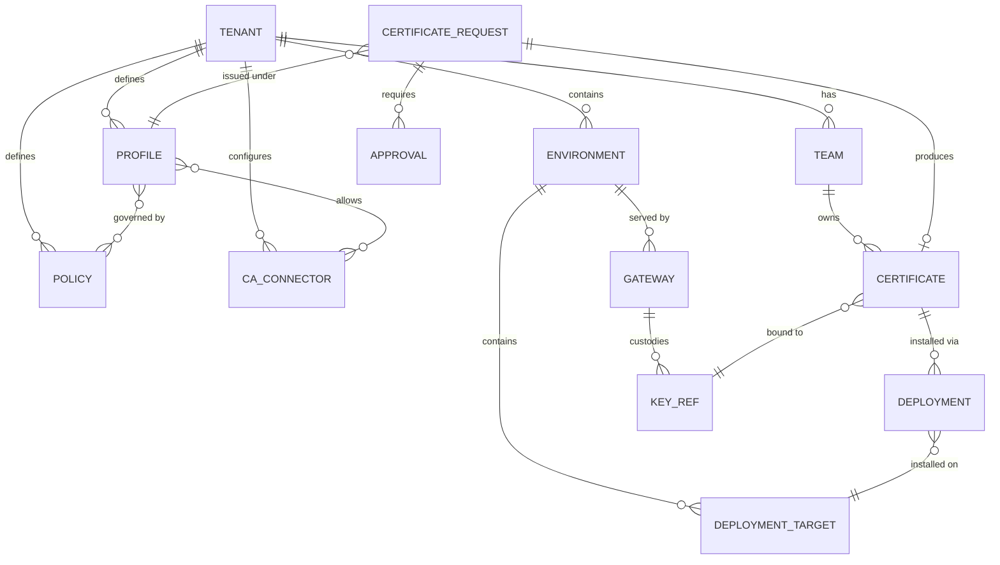
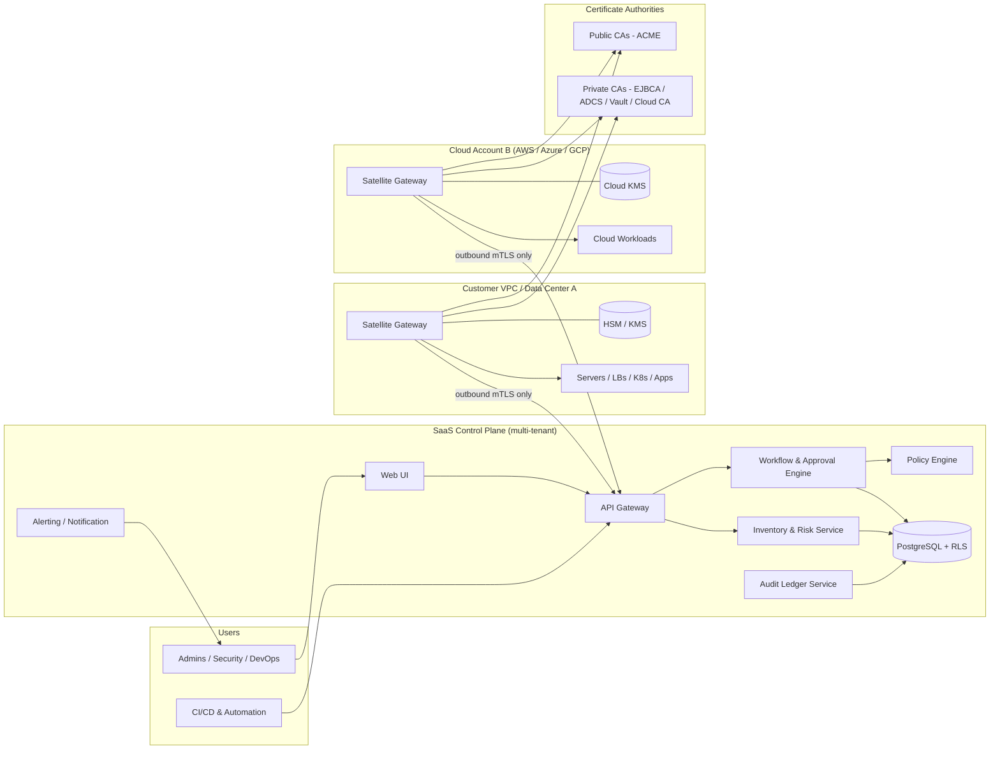
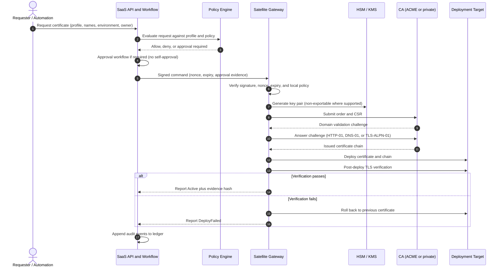
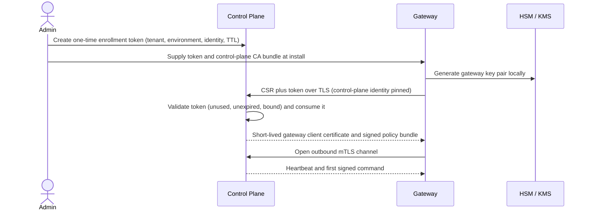
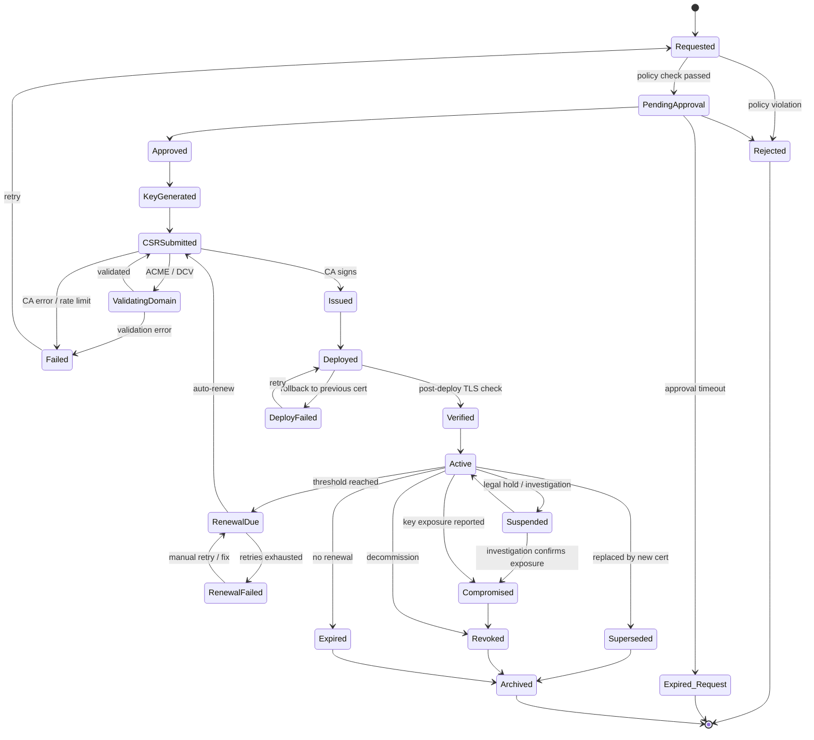

# Certificate Lifecycle Management (CLM)

> Discover, issue, deploy, renew, rotate, and revoke X.509 certificates across **multi-cloud**, **on-prem**, and **hybrid** environments, from one control plane, while private keys stay inside **your** infrastructure.


---

## Table of Contents

1. [Overview](#1-overview)
2. [Scope, Non-Goals & Personas](#2-scope-non-goals--personas)
3. [Core Concepts & Data Model](#3-core-concepts--data-model)
4. [Why CLM? The 47-Day Certificate Problem](#4-why-clm-the-47-day-certificate-problem)
5. [Key Features](#5-key-features)
6. [Architecture](#6-architecture)
7. [Deployment Models](#7-deployment-models)
8. [Satellite Gateway (In-VPC Enclave)](#8-satellite-gateway-in-vpc-enclave)
9. [Gateway Operations: Enrollment, Connectivity & Offline Behavior](#9-gateway-operations-enrollment-connectivity--offline-behavior)
10. [Multi-Cloud Support](#10-multi-cloud-support)
11. [Certificate & Identity Types](#11-certificate--identity-types)
12. [Certificate Lifecycle](#12-certificate-lifecycle)
13. [Supported Protocols & CAs](#13-supported-protocols--cas)
14. [Domain Control Validation (DCV)](#14-domain-control-validation-dcv)
15. [Private CA & PKI Management](#15-private-ca--pki-management)
16. [Discovery & Inventory](#16-discovery--inventory)
17. [Policy, Governance & Approvals](#17-policy-governance--approvals)
18. [Roles & Permissions](#18-roles--permissions)
19. [Incident Response: CA Distrust & Key Compromise](#19-incident-response-ca-distrust--key-compromise)
20. [Integrations](#20-integrations)
21. [Reporting & Analytics](#21-reporting--analytics)
22. [Security Model](#22-security-model)
23. [Threat Model](#23-threat-model)
24. [Shared Responsibility Model](#24-shared-responsibility-model)
25. [Multi-Tenancy & Data Isolation](#25-multi-tenancy--data-isolation)
26. [Audit Trail](#26-audit-trail)
27. [Observability & Alerting](#27-observability--alerting)
28. [Reliability, Backup & Disaster Recovery](#28-reliability-backup--disaster-recovery)
29. [Performance, Scale & Capacity Planning](#29-performance-scale--capacity-planning)
30. [Data Privacy, Retention & Residency](#30-data-privacy-retention--residency)
31. [Crypto-Agility & Post-Quantum Readiness](#31-crypto-agility--post-quantum-readiness)
32. [Technology Stack](#32-technology-stack)
33. [Repository Structure](#33-repository-structure)
34. [Getting Started](#34-getting-started)
35. [Onboarding & Migration](#35-onboarding--migration)
36. [Configuration](#36-configuration)
37. [API & Automation](#37-api--automation)
38. [Upgrades & Maintenance](#38-upgrades--maintenance)
39. [Testing & Quality](#39-testing--quality)
40. [Platform Support](#40-platform-support)
41. [Compliance Alignment](#41-compliance-alignment)
42. [Limitations & Known Constraints](#42-limitations--known-constraints)
43. [Roadmap](#43-roadmap)
44. [FAQ & Troubleshooting](#44-faq--troubleshooting)
45. [Glossary](#45-glossary)
46. [Reference Platforms](#46-reference-platforms)
47. [Versioning, Support & Community](#47-versioning-support--community)
48. [Contributing](#48-contributing)
49. [Platform Feature Catalogue](#49-platform-feature-catalogue)
50. [License](#50-license)

---

## 1. Overview

CLM is an enterprise platform for managing the full lifecycle of digital certificates and the keys behind them. It is built around a **hybrid topology**:

| Plane | Runs where | Responsibility |
|---|---|---|
| **SaaS Control Plane** | Multi-tenant cloud | Inventory metadata, policy, workflows, approvals, UI, analytics, alerting |
| **Satellite Gateway** | Inside the customer's VPC / data center | Key custody (HSM / KMS), CSR generation, signing, certificate deployment, discovery scans, local evidence storage |

**Design principle:** the SaaS orchestrates; the Satellite Gateway holds the keys. Private keys never leave customer infrastructure.

> **Terminology note:** this is a *customer-held-key / data-residency* model. We deliberately avoid the term "zero-knowledge", which has a specific cryptographic meaning that does not apply here. Metadata such as subject names, SANs, expiry dates, and issuer reaches the SaaS by design. See [Data Boundaries](#63-data-boundaries).

### At a glance

| | |
|---|---|
| **Manages** | X.509 certificates and the keys behind them: public TLS, private PKI, mTLS, S/MIME, code signing, device identities |
| **Key custody** | Customer-owned HSM / KMS through the Satellite Gateway; private keys never reach the SaaS |
| **Connectivity** | Gateways dial out over mutual TLS on port 443; no inbound ports |
| **Automation** | ACME v2 (including ARI), EST, SCEP, CMP, vendor CA APIs; verify-then-activate deployment with automatic rollback |
| **Governance** | Policy-as-code, approvals with segregation of duties, CAA checks, risk scoring |
| **Evidence** | Hash-chained, Merkle-anchored audit ledger with RFC 3161 timestamps |
| **Interfaces** | Web UI, REST API (OpenAPI 3.1), `clm` CLI, Terraform provider, signed webhooks |
| **Tenancy** | PostgreSQL Row-Level Security with per-tenant keys for sensitive fields |

### How to read this document
- Capabilities described here are the **target design**. The [Roadmap](#43-roadmap) shows what has shipped.
- Commands, endpoints, and configuration keys are **illustrative** until they match your release. `<angle-brackets>` and `example.com` are placeholders.
- Items labelled *planned* or *roadmap* are not yet available.

| If you are... | Start with |
|---|---|
| Evaluating CLM | [Key Features](#5-key-features), [Architecture](#6-architecture), [Shared Responsibility Model](#24-shared-responsibility-model) |
| A security or PKI engineer | [Private CA & PKI Management](#15-private-ca--pki-management), [Policy, Governance & Approvals](#17-policy-governance--approvals), [Security Model](#22-security-model), [Threat Model](#23-threat-model) |
| A platform or DevOps engineer | [Getting Started](#34-getting-started), [Configuration](#36-configuration), [API & Automation](#37-api--automation), [Integrations](#20-integrations) |
| In compliance or audit | [Audit Trail](#26-audit-trail), [Compliance Alignment](#41-compliance-alignment), [Reporting & Analytics](#21-reporting--analytics), [Data Privacy, Retention & Residency](#30-data-privacy-retention--residency) |
| Operating CLM in production | [Reliability, Backup & Disaster Recovery](#28-reliability-backup--disaster-recovery), [Upgrades & Maintenance](#38-upgrades--maintenance), [FAQ & Troubleshooting](#44-faq--troubleshooting) |
| Migrating from another tool | [Onboarding & Migration](#35-onboarding--migration), [Discovery & Inventory](#16-discovery--inventory) |

---

## 2. Scope, Non-Goals & Personas

### In scope
- Machine and workload identity certificates (TLS server, mTLS client, internal services)
- Private PKI management (issuing CAs, templates, revocation distribution)
- Public CA orchestration (ACME and vendor APIs)
- Discovery, inventory, risk scoring, policy, approvals, audit

### Optional / separate module
- **Contract lifecycle management** (document workflows, clause diffs, e-signature evidence). It follows the same hybrid model but is documented separately. If it is not part of your deployment, ignore document-related references in the architecture notes.

### Non-goals
- CLM is **not a public CA** and does not issue publicly trusted certificates itself.
- It is **not an HSM**; it integrates with HSMs and KMS.
- It is **not a general secrets manager**; it complements Vault, Key Vault, and similar.

### Personas
| Persona | Typical goals |
|---|---|
| **PKI / Security Engineer** | Define profiles and policy, run private CAs, respond to incidents |
| **Platform / DevOps Engineer** | Automate issuance and renewal in CI/CD and Kubernetes |
| **Application Owner** | See expiry of their certificates, request new ones |
| **Compliance / Audit** | Prove control: who issued what, under which policy, with which approval |
| **Cloud Architect** | Standardize across AWS, Azure, GCP, and on-prem |
| **SOC / Incident Responder** | Revoke and replace at scale after compromise or CA distrust |

---

## 3. Core Concepts & Data Model

This section defines the vocabulary used throughout the document.

| Concept | Description |
|---|---|
| **Tenant** | Top-level isolation boundary (one customer organization). Every record carries a `tenant_id` enforced by Row-Level Security. |
| **Environment** | A cloud account, VPC, data center, or Kubernetes cluster registered with CLM (for example `aws-prod`). Bound to one or more gateways. |
| **Gateway** | A Satellite Gateway instance that holds keys and executes operations for its environments. |
| **Key store** | Where keys live: PKCS#11 HSM, cloud KMS, or software keystore. |
| **Key reference** | A handle to a key in a key store. CLM records the reference, never key material. |
| **CA connector** | Configured adapter to a public or private CA. Credentials are referenced from the customer secret manager. |
| **Certificate profile** | Template for what may be issued: key algorithms, validity, subject and SAN rules, key usage / EKU, allowed CAs, approval and renewal settings. |
| **Policy** | Declarative rules evaluated before every state transition, and re-evaluated locally by the gateway. |
| **Certificate request** | Intent to obtain or renew a certificate under a profile. Drives the workflow. |
| **Certificate** | An issued X.509 certificate record, identified by its SHA-256 fingerprint and linked to a key reference. |
| **Deployment target** | A place where a certificate is installed (NGINX host, load balancer, Kubernetes secret, Java keystore, and so on). |
| **Owner / Team** | The accountable person and team. Mandatory for every certificate. |
| **Approval** | A recorded decision by an authorized approver, bound to the hash of a specific request. |
| **Evidence bundle** | Signed, exportable package: request, policy decision, approvals, issuance, deployment verification, and audit proofs. |
| **Audit event** | Immutable record of a mutation, chained into the tenant ledger. |

### Entity relationships



### Identifiers and conventions
- Certificates are identified by the **SHA-256 fingerprint of the DER encoding**; issuer plus serial number is used for CA-side lookups.
- Resource IDs are opaque and sortable. Clients must not parse them.
- All timestamps are **UTC, RFC 3339**.
- **Tags** are key/value pairs on environments, targets, and certificates. Policy can require specific tags (for example `owner`, `cost-center`, `data-classification`).
- Certificates are **archived, never hard-deleted**, while inside their retention period (see [Data Privacy, Retention & Residency](#30-data-privacy-retention--residency)).
- State changes use optimistic concurrency (entity versions / ETags), so two actors cannot silently overwrite each other.

---

## 4. Why CLM? The 47-Day Certificate Problem

Public TLS certificate validity is shrinking under the CA/Browser Forum Ballot SC-081:

| Effective date | Maximum validity |
|---|---|
| Before 15 Mar 2026 | 398 days |
| 15 Mar 2026 | 200 days |
| 15 Mar 2027 | 100 days |
| 15 Mar 2029 | 47 days |

Manual renewal (spreadsheets, calendar reminders) does not scale at those cadences. CLM assumes **full automation** (ACME and agent-based deployment) as the default operating mode.

Common problems CLM addresses:

- Outages from expired or forgotten certificates
- Shadow certificates issued outside central control
- Fragmented ownership across AWS, Azure, GCP, on-prem, and Kubernetes
- Weak or inconsistent crypto (SHA-1, RSA-1024, wildcard sprawl)
- Slow incident response when a CA is distrusted or a key is compromised
- Audit gaps: no proof of who issued what, when, and why

---

## 5. Key Features

**Lifecycle automation**
- Request, approve, issue, deploy, renew, rotate, revoke, archive
- Zero-touch renewal through ACME v2 and deployment agents
- Bulk operations and blue/green rotation

**Discovery & visibility**
- Network (TLS port) scanning, cloud-API discovery, Kubernetes, load balancers, CT-log monitoring
- Unified inventory with owner, environment, application, and cloud-account tags
- Expiry heat map and risk scoring

**Policy & governance**
- Per-tenant crypto policy (algorithms, key sizes, validity, SAN rules, allowed CAs)
- Multi-step approval workflows with segregation of duties
- Certificate profiles and templates
- CAA record verification before issuance

**Key custody**
- PKCS#11 HSM, cloud KMS, and software keystore backends
- Keys generated and kept in customer environment
- Optional M-of-N approval for sensitive signing operations

**Multi-cloud and hybrid**
- Native connectors for AWS, Azure, GCP, Cloudflare, Oracle Cloud, IBM Cloud
- On-prem Satellite Gateways for air-gapped and regulated networks

**Operations**
- Webhooks, REST API, Terraform provider, CLI
- Slack / Teams / email / PagerDuty alerting
- ITSM integration (ServiceNow, Jira)

**Auditability**
- Tamper-evident, hash-chained audit log with external anchoring
- Exportable evidence packages

**Reporting & crypto-agility**
- Scheduled reports, KPIs, and audit evidence packs
- Cryptographic Bill of Materials (CBOM) export and post-quantum readiness tracking
- Break-glass issuance with mandatory after-the-fact review
- Policy exceptions that expire automatically

---

## 6. Architecture

### 6.1 High-level topology



### 6.2 Core services

| Service | Purpose |
|---|---|
| **API Gateway** | AuthN/Z, rate limiting, tenant context injection, routing |
| **Workflow Engine** | State machine for request, approval, issuance, deployment |
| **Policy Engine** | Evaluates crypto and governance rules before any signing |
| **Inventory Service** | Certificate and key metadata, ownership, dependencies |
| **Discovery Orchestrator** | Schedules scans and ingests results from gateways and cloud APIs |
| **CA Connector Layer** | Adapters for public and private CAs |
| **Notification Service** | Expiry, failure, and policy-violation alerts |
| **Audit Ledger** | Hash-chained, externally anchored event log |
| **Satellite Gateway** | Local executor for key operations and deployment |

### 6.3 Data boundaries

| Data | SaaS | Gateway |
|---|---|---|
| Private keys | Never | Yes (HSM/KMS) |
| Certificate (public part) | Yes | Yes |
| CSR | Yes (public data) | Yes |
| Subject / SAN / issuer / validity | Yes | Yes |
| Contract or document content (if CLM contract features are enabled) | Only derived metadata, if configured | Yes (encrypted blobs) |
| Audit hashes and signed tree heads | Yes | Yes (local copy) |
| Deployment credentials (SSH, API tokens) | Never stored in plaintext; referenced via customer secret manager | Yes, local only |

Anything derived from content (clause diffs, embeddings, summaries) is **content-bearing** and must be treated as such. Run AI/analysis workloads inside the gateway, or explicitly opt in to SaaS-side processing.

### 6.4 End-to-end issuance flow



The control plane never dials into the customer network. Commands reach the gateway over the **outbound-initiated** mTLS channel.

### 6.5 Failure domains

| If this fails | Impact | Behavior |
|---|---|---|
| Control plane | No new requests, UI unavailable | Gateways continue pre-approved renewals within the grace window; new requests wait |
| Gateway | Operations for its environments pause | Standby takes over; alert raised |
| HSM / KMS | No signing in that environment | Fail closed; alert raised |
| Public or private CA | Issuance from that CA blocked | Retry with backoff; switch the profile to an alternate CA |
| DNS provider | DNS-01 validation fails | Retry; use HTTP-01 where allowed |
| Message queue | Workflow events delayed | Durable queue, idempotent consumers, dead-letter handling |
| Database primary | Brief write interruption | Failover to synchronous replica; clients retry |
| Deployment target unreachable | Deployment fails | Roll back, retry, alert |

---

## 7. Deployment Models

| Model | Description | Best for |
|---|---|---|
| **SaaS + Cloud Gateway** | Gateway runs in your AWS/Azure/GCP account | Cloud-first teams |
| **SaaS + On-Prem Gateway** | Gateway in data center, outbound-only connectivity | Regulated and legacy estates |
| **Multi-Gateway Mesh** | Many gateways per tenant (per region, cloud, or business unit) | Global enterprises |
| **Air-Gapped / Offline** | Gateway operates with batched, signed, sneaker-net sync | Defense, OT, critical infrastructure |
| **Self-Hosted Control Plane** | Full stack deployed in customer environment | Sovereign and strict-residency requirements |

### Choosing a model
| If you need... | Choose |
|---|---|
| Fastest start in AWS, Azure, or GCP | SaaS + Cloud Gateway |
| Coverage for data centers, branch sites, or legacy systems | SaaS + On-Prem Gateway |
| Separate trust zones, regions, or business units | Multi-Gateway Mesh |
| No connectivity to the internet at all | Air-Gapped / Offline |
| Full data sovereignty or no third-party control plane | Self-Hosted Control Plane |

### Gateway placement guidance
- Run **at least one gateway per trust zone**. Do not share a gateway across zones that must stay isolated (for example production and corporate IT).
- Place gateways close to the HSM / KMS they use and to the targets they deploy to.
- Use **active/standby pairs** for production sites.
- Keep one gateway per cloud account or region when data-residency rules apply.

---

## 8. Satellite Gateway (In-VPC Enclave)

A lightweight daemon deployed in the customer's network.

**Responsibilities**
- Generate key pairs inside HSM/KMS (non-exportable where supported)
- Build and sign CSRs
- Execute ACME challenges (HTTP-01, DNS-01, TLS-ALPN-01) locally
- Deploy certificates to targets (NGINX, Apache, IIS, HAProxy, F5, Citrix, Kubernetes secrets, cloud load balancers, Java keystores)
- Run discovery scans on internal networks
- Store encrypted evidence bundles locally
- Enforce a **local policy** independent of SaaS instructions

**Connectivity**
- **Outbound-only mutual TLS** to the control plane (no inbound ports)
- Commands are **signed**, carry nonce and expiry, and are replay-protected
- Gateway verifies signatures and local policy before acting

**Why local policy matters:** if the control plane were compromised, it must not be able to force the gateway to sign arbitrary certificates. The gateway independently checks allowed domains, algorithms, validity, and approval evidence.

**High availability:** active/standby gateways per site, with shared HSM access.

**Process isolation:** PKCS#11 bindings run in a minimal, separate signing process to contain native-code risk.

### Key handling for deployment targets

A TLS server must be able to use its private key. How the key reaches (or avoids reaching) the target depends on the mode, and policy chooses the mode per profile.

| Mode | How it works | Assurance | Typical targets |
|---|---|---|---|
| **Key stays in HSM / KMS** | Target signs through PKCS#11 or a KMS-backed key provider; the key is never exported | Highest | Servers and proxies with PKCS#11 or key-provider support; provider-managed keys on cloud services |
| **Key generated on the target** | A host agent creates the key and CSR locally; the gateway receives only the CSR and returns the certificate | High | Servers, Windows cert stores, appliances that generate their own keys |
| **Key generated by the gateway and delivered** | The gateway generates the key, wraps it to the target, and delivers it over an authenticated channel | Lower: the key exists on the target and was exported from the gateway | Load balancers and appliances that only accept key import |

The platform records which mode each certificate used and can flag certificates that use the lowest-assurance mode. Short lifetimes limit exposure in every mode.

### Deployment mechanisms
| Mechanism | How it works | Use for |
|---|---|---|
| **Gateway-driven (agentless)** | Gateway connects over SSH, WinRM, vendor API, or cloud API, using credentials from the customer secret manager | Load balancers, appliances, cloud services |
| **Host agent (optional)** | Small agent on the host talks only to the local gateway over mTLS; installs, reloads, scans cert stores | Large server fleets, Windows cert stores, strict network segmentation |
| **Kubernetes-native** | cert-manager issuer or CSI driver | Clusters and service meshes |

### Key stores and algorithms
| Key store | Notes |
|---|---|
| **PKCS#11 HSM** | Preferred for CA keys and high-value keys; non-exportable keys; the device may be FIPS 140-3 validated |
| **Cloud KMS / HSM** | AWS KMS and CloudHSM, Azure Key Vault and Managed HSM, GCP Cloud KMS / HSM |
| **Software keystore** | Encrypted at rest with a key-encryption key held in KMS; for development and low-risk use; **not recommended for CA keys** |

Supported key types: RSA (2048 to 4096) and ECDSA (P-256, P-384) for web PKI. EdDSA is limited to private PKI and workload identity. Profiles restrict which are allowed.

---

## 9. Gateway Operations: Enrollment, Connectivity & Offline Behavior

### Enrollment and trust bootstrap
1. An admin creates a **one-time, short-lived enrollment token** bound to tenant, environment, and expected gateway identity.
2. The gateway generates its own key pair **locally** (HSM/KMS where available) and submits a CSR with the token.
3. The control plane issues a **gateway client certificate** from a dedicated gateway CA. The token is consumed and cannot be reused.
4. Gateway certificates are **short-lived and auto-rotated**; revoking a gateway cuts off its channel immediately.

### Network requirements
| Direction | Destination | Port | Purpose |
|---|---|---|---|
| Outbound | CLM control plane | 443 (mTLS) | Commands, policy, status |
| Outbound | Public CA / ACME endpoints | 443 | Issuance |
| Outbound | DNS provider APIs | 443 | DNS-01 challenges |
| Outbound | NTP | 123/UDP | Accurate time (certificate validity, replay windows) |
| Local | HSM / KMS | Vendor specific | Signing |
| Local | Deployment targets | 22 / 443 / vendor APIs | Certificate installation |
| Inbound | **None from the internet** | n/a | Control-plane channel is outbound only |

Outbound HTTP(S) proxies are supported for restricted networks.

### Behavior when the control plane is unreachable
- The gateway keeps a **signed policy bundle** with an expiry (grace window, configurable).
- Within the grace window it continues **scheduled renewals** for already-approved profiles, under the cached policy.
- **New or out-of-policy requests are refused** (fail closed). Expired policy bundles stop all new issuance.
- Audit events are written to a **local hash chain** and replayed to the control plane on reconnect; gaps or reordering are detectable.
- Clock skew beyond tolerance blocks signing, since replay protection depends on time.

### Gateway upgrades
Signed releases, staged rollout, and automatic rollback; active/standby pairs upgrade one at a time.

### Enrollment sequence



Install the **control-plane CA bundle together with the token**, so a network attacker cannot impersonate the control plane during enrollment.

### Gateway lifecycle
| Event | Procedure |
|---|---|
| **Certificate rotation** | Automatic, well before expiry; alert if rotation fails with time remaining |
| **Replacement or migration** | Enroll the new gateway to the same environment, move bindings, verify a test renewal, then retire the old one |
| **Decommission** | Revoke the gateway certificate, drain pending jobs, export the local audit chain and evidence, disable or delete key access in the HSM / KMS |
| **Suspected compromise** | Revoke the gateway certificate, disable its key access in the HSM / KMS, enroll a replacement, re-key affected certificates, follow [Incident Response: CA Distrust & Key Compromise](#19-incident-response-ca-distrust--key-compromise) |
| **Gateway CA rotation** | Control plane trusts both old and new gateway CAs during an overlap window, then removes the old one |
| **Lost local state** | Re-enroll; policy and configuration come from the control plane; back up the local audit buffer if it has not yet been replayed |

---

## 10. Multi-Cloud Support

| Provider | Capabilities |
|---|---|
| **AWS** | ACM import/sync, ACM Private CA, KMS/CloudHSM, ELB/CloudFront/API Gateway deployment, Route 53 DNS-01 |
| **Microsoft Azure** | Key Vault certificates/keys/Managed HSM, Application Gateway / Front Door deployment, Azure DNS |
| **Google Cloud** | Certificate Authority Service, Cloud KMS/HSM, Certificate Manager, Cloud DNS |
| **Cloudflare** | Edge certificates, origin CA, DNS-01 |
| **Oracle Cloud (OCI)** | Certificates service, Vault, load balancer deployment |
| **IBM Cloud** | Secrets Manager (successor to the legacy Certificate Manager), Hyper Protect Crypto Services |
| **On-Prem / Other** | AD CS, EJBCA, HashiCorp Vault PKI, F5, Citrix, Windows cert stores, Java keystores |
| **Kubernetes** | cert-manager integration, CSI driver, Istio/Linkerd mTLS, ingress controllers |

Each cloud account or on-prem site is registered as an **Environment** and bound to one or more gateways.

### Credential model
Prefer **workload identity** over static keys: IAM roles for service accounts (AWS), managed identities (Azure), and workload identity federation (GCP). No long-lived cloud access keys should be stored in CLM.

### Typical permissions (scope each narrowly)
| Provider | Typical permissions |
|---|---|
| **AWS** | `acm:ListCertificates`, `acm:DescribeCertificate`, `acm:ImportCertificate`, `acm:AddTagsToCertificate`; `route53:ChangeResourceRecordSets` limited to the validation zone; load-balancer listener certificate actions limited to named listeners |
| **Azure** | Key Vault certificate permissions on specific vaults; DNS zone contributor limited to the validation zone; Application Gateway / Front Door update rights on named resources |
| **Google Cloud** | Certificate Manager and CAS roles on specific projects; a custom DNS role limited to record sets in the validation zone |
| **Cloudflare** | API token scoped to the zone, with DNS edit and SSL/certificate permissions only |

Review these grants during the quarterly access review ([Upgrades & Maintenance](#38-upgrades--maintenance)).

---

## 11. Certificate & Identity Types

| Type | Notes |
|---|---|
| **TLS server** | Public (ACME / vendor CA) and private; the primary use case |
| **TLS client / mTLS** | Use a **private CA**; public CAs are dropping client-auth usage |
| **Internal service / workload** | Short-lived certificates, SPIFFE/SPIRE-compatible identities |
| **S/MIME (email)** | Enrollment and renewal via vendor CA or private CA |
| **Code signing** | Keys held in HSM, approval-gated, timestamped signatures |
| **Document signing** | Hash-only signing flow; documents stay in customer environment |
| **Device / IoT** | EST / SCEP enrollment, bulk provisioning |
| **User / Wi-Fi / VPN** | Integration with MDM and identity providers |
| **SSH certificates** | Short-lived SSH CA integration (roadmap) |

### Validity and renewal guidance by type
| Type | Guidance |
|---|---|
| **Public TLS server** | Follow the CA/B Forum maximum for the date (see [Why CLM? The 47-Day Certificate Problem](#4-why-clm-the-47-day-certificate-problem)); fully automated |
| **Private TLS server** | Choose by risk; shorter is better when automation exists |
| **mTLS / workload identity** | Very short-lived (hours to days) with automatic rotation |
| **S/MIME** | Follow the CA's policy and the S/MIME Baseline Requirements |
| **Code signing** | HSM-bound keys, approval-gated, timestamped signatures so signatures outlive the certificate |
| **Device / IoT** | Match device lifetime and update capability; plan for re-enrollment |

---

## 12. Certificate Lifecycle



Failed deployments **roll back automatically** to the previous certificate, and a post-deployment TLS check (chain, SAN, expiry, protocol) must pass before a certificate is marked Active.

Every transition:
- is validated by the policy engine,
- uses optimistic concurrency to avoid conflicting updates,
- emits an immutable audit event.

### Renewal and rotation strategy
| Topic | Default behavior |
|---|---|
| **Key on renewal** | **Re-key on every renewal.** Key reuse is blocked by default and flagged in risk scoring if allowed. |
| **Timing** | Start at a fraction of the lifetime (scaled automatically for short-lived certificates). When the CA supports **ARI**, follow the CA's suggested window. |
| **Jitter** | Randomized start within the window to avoid renewal storms |
| **Retries** | Exponential backoff, then `RenewalFailed` and an alert with enough time left to fix the cause |
| **Overlap** | The new certificate is deployed and verified **before** the old one is retired; the old one stays available for rollback |
| **Fleet rotation** | Blue/green or canary waves: deploy to a subset, verify, then continue |

### Revocation reasons
Revocation uses **RFC 5280** reason codes: `keyCompromise`, `cACompromise`, `affiliationChanged`, `superseded`, `cessationOfOperation`, `privilegeWithdrawn`, and `certificateHold` (private CAs). Public CAs accept only the reasons permitted by the CA/Browser Forum Baseline Requirements. The reason is mandatory, recorded in the audit log, and drives the playbook (for example `keyCompromise` triggers re-key and incident evidence).

### Post-deployment verification checks
A certificate becomes **Active** only after all of these pass:
- Chain is complete and correctly ordered
- Leaf SAN matches the intended names
- Not expired and not yet-valid
- The deployed certificate matches the issued one (fingerprint) and the endpoint completes a handshake with the expected key
- Protocol versions and cipher suites meet policy
- Service reload succeeded and the health check passes

Any failure triggers automatic rollback to the previous certificate.

---

## 13. Supported Protocols & CAs

**Enrollment protocols**

| Protocol | Use |
|---|---|
| **ACME v2 (RFC 8555)** | Public and private web PKI automation, ACME Renewal Information (ARI) |
| **EST (RFC 7030)** | Device and IoT enrollment |
| **SCEP** | Legacy network devices, MDM |
| **CMP (RFC 4210)** | Enterprise PKI |
| **PKCS#10 / PKCS#12 / PEM / DER** | Formats |

**Revocation & transparency**
- CRL (primary) and OCSP (where still supported)
- Certificate Transparency monitoring (RFC 6962 / RFC 9162)
- CAA enforcement (RFC 8659)

**CA connectors**
- Public: DigiCert, Sectigo, GlobalSign, Entrust, SSL.com, Let's Encrypt, ZeroSSL, SwissSign, TrustAsia, IdenTrust
- Private: EJBCA, Microsoft AD CS, HashiCorp Vault PKI, Smallstep, OpenXPKI, AWS Private CA, Google CAS

**Public CA ecosystem changes CLM accounts for**
- OCSP is being phased out by major public CAs; CRLs are the primary revocation channel.
- Public CAs are removing the *TLS client authentication* EKU from publicly trusted server certificates (driven by browser root-program policy). Use a **private CA** for mTLS client identities, and verify each CA's timeline.
- Domain-validation reuse periods shrink alongside certificate lifetimes (see [DCV](#14-domain-control-validation-dcv)).

**CA agility:** switch issuing CAs per profile with no application changes, which matters for distrust events and pricing.

### CA connector contract
Every connector implements the same interface, so profiles can switch CAs without application changes:
- `Issue`, `Renew`, `Revoke`, `GetStatus`
- Product / profile discovery and validation of requested names
- Domain-validation support (where the CA offers it)
- Rate-limit metadata and health checks
- Credentials by reference to the customer secret manager, including ACME **External Account Binding (EAB)** where required

The same **connector contract test suite** runs against every connector (see [Testing & Quality](#39-testing--quality)).

### Adding a new connector
1. Implement the connector interface under `internal/connectors/<name>/`.
2. Add configuration schema, secret references, and rate-limit metadata.
3. Pass the connector contract tests against a test instance or recorded fixtures.
4. Document supported features and limitations in `docs/connectors/<name>.md`.

---

## 14. Domain Control Validation (DCV)

Public CAs must validate domain control, and the allowed **reuse period of validation is shrinking** together with certificate lifetimes (200 days from March 2026, 100 days from March 2027, 10 days from March 2029 under SC-081). Treat validation as something to automate, not a one-off task.

CLM supports:
- **HTTP-01** (single hostnames, no wildcards)
- **DNS-01** (wildcards; requires scoped DNS API access held by the gateway)
- **TLS-ALPN-01** (where port 443 handling allows)
- **CNAME delegation** of `_acme-challenge.<domain>` to a controlled validation zone, so application teams never need broad DNS credentials
- **CAA pre-checks** before every order, with alerts when CAA would block the chosen CA
- **Rate-limit awareness** per CA (staggered renewals, jitter, backoff)

Scope DNS credentials to the narrowest zone possible and keep them in the customer secret manager, not in the SaaS.

### Choosing a challenge
| Situation | Recommended method |
|---|---|
| Public web server reachable on port 80 | HTTP-01 |
| Wildcard certificate | DNS-01 (preferably through CNAME delegation) |
| Internal hostname that needs a publicly trusted certificate | DNS-01. Note that the name appears in CT logs. |
| Only port 443 is reachable | TLS-ALPN-01 |
| No DNS API access and no reachable port | Use a private CA |

### CNAME delegation example
```text
; Created once in the application's zone
_acme-challenge.app.example.com.  IN  CNAME  app.example.com.validation.corp.example.net.

; The gateway holds credentials only for validation.corp.example.net
; and writes each TXT challenge record there.
```

### CAA examples
```text
example.com.  IN  CAA  0 issue "letsencrypt.org; accounturi=https://acme-v02.api.letsencrypt.org/acme/acct/<id>; validationmethods=dns-01"
example.com.  IN  CAA  0 issuewild "digicert.com"
example.com.  IN  CAA  0 iodef "mailto:security@example.com"
```
The `accounturi` and `validationmethods` parameters (RFC 8657) bind issuance to your ACME account and challenge type, where the CA supports them.

---

## 15. Private CA & PKI Management

| Topic | Guidance |
|---|---|
| **Hierarchy** | Offline root, online intermediate(s) per environment or purpose; separate CAs for TLS, client auth, and code signing |
| **Root key ceremony** | Scripted, witnessed, HSM-backed; M-of-N custodians; recorded evidence stored in audit log |
| **Name constraints** | Restrict intermediates to allowed domains where possible |
| **Revocation distribution** | CRL distribution points with high availability; OCSP only where operationally justified |
| **CA rotation** | Planned overlap period, cross-signing where needed, trust-store rollout tracking |
| **Backends** | EJBCA, Microsoft AD CS, HashiCorp Vault PKI, Smallstep, OpenXPKI, AWS Private CA, Google CAS |
| **Trust-store distribution** | Track which devices and workloads trust which roots; flag unmanaged trust anchors |
| **Algorithm agility** | Inventory of algorithms and key sizes to plan migration (including post-quantum) |

Root CA private keys are **never** held by the SaaS control plane.

### Private certificate profile example
```yaml
profile: internal-mtls-client
ca: corp-issuing-ca
key:
  algorithms: [ECDSA-P256]
  non_exportable: true
validity_days_max: 30
subject:
  dn_template: "CN=${identity},OU=${team},O=Example Corp"
key_usage: [digitalSignature]
extended_key_usage: [clientAuth]
san:
  allowed_types: [uri, dns]
  uri_prefixes: ["spiffe://example.com/"]
revocation:
  crl: true
  ocsp: false
approval:
  required: false
  auto_approve_for: [svc-automation]
```

### Revocation operations
- Publish CRLs on a fixed schedule with an **overlap** between `thisUpdate` and `nextUpdate` so clients never see an expired CRL.
- Serve CRLs from a highly available, cacheable endpoint; **alert on CRL staleness** before `nextUpdate`.
- If OCSP is used, sign responses with a dedicated OCSP signing certificate, not the CA key.
- Record every revocation with its reason code and requester in the audit log.

---

## 16. Discovery & Inventory

| Source | Method |
|---|---|
| Network | TLS handshake scans on CIDR ranges and ports (via gateways) |
| Cloud | Provider APIs (ACM, Key Vault, CAS, Cloudflare, etc.) |
| Kubernetes | Secrets, Ingress, cert-manager resources |
| Hosts | Agent / file-system and cert-store scans |
| Code & CI | Repository and pipeline scanning for embedded certs and keys |
| Public | CT-log monitoring for unexpected issuance on your domains |

Each inventory record includes: subject, SANs, issuer, serial, fingerprint, key type/size, signature algorithm, validity, location(s), owner, environment, tags, and dependency map.

**Risk scoring** flags: expiring soon, weak algorithm, wildcard overuse, missing owner, unmanaged CA, key shared across hosts, long validity, and non-compliant profile.

### Scan scheduling and scope
- Define scopes by CIDR, port list, and SNI name list; use exclusion lists for sensitive ranges.
- Schedule scans per environment with rate limits and off-peak windows.
- Scans are **TLS handshakes only**: no authentication attempts and no vulnerability probing.
- Gateways send results encrypted to the control plane; results are de-duplicated by fingerprint and change-detected.

### Ownership assignment and orphans
- Auto-assign owners from cloud account tags, Kubernetes namespace labels, and CMDB records.
- Certificates with no owner go to an **unowned queue** with escalation to the environment admin.
- When the identity provider reports that an owner left (via SCIM), their certificates are flagged for reassignment.

### Shadow-certificate triage
`Unmanaged` → `Claimed` (owner assigned) → `Managed` (renewed by CLM) or `Retired`. Findings that stay unmanaged past a configurable age raise alerts and show in [Reporting & Analytics](#21-reporting--analytics).

### CBOM export
The inventory can be exported as a **Cryptographic Bill of Materials** (for example in CycloneDX cryptographic-asset format) listing algorithms, key sizes, and certificate chains, to support [Crypto-Agility & Post-Quantum Readiness](#31-crypto-agility--post-quantum-readiness).

---

## 17. Policy, Governance & Approvals

- **Policy-as-code** (declarative; versioned; dry-run mode)
- **Role-based and attribute-based access control** (RBAC/ABAC)
- **Segregation of duties** (requester cannot approve own request)
- **Approval chains** per environment or profile
- **Expiry thresholds** (for example 45/30/14/7/1 days; scaled automatically for short-lived certs)
- **Ownership enforcement** (every certificate must have an owner and a team)

Example policy fragment:

```yaml
profile: prod-web-tls
allowed_cas: [digicert-public, lets-encrypt]
key:
  algorithms: [ECDSA-P256, RSA-3072]
validity_days_max: 90
san:
  allowed_suffixes: [".example.com"]
  wildcard: require_approval
approval:
  required: true
  approvers: [security-team]
renewal:
  automatic: true
  start_before_days: 30
caa_check: enforce
```

### Policy lifecycle
`Draft` → `Dry-run` (shows what would be blocked, no enforcement) → `Peer review` (second person approves) → `Staged rollout` → `Active`. Policies are **versioned and signed**; gateways receive them in signed policy bundles and can roll back to a prior version.

Validate policy in CI before it reaches the control plane:
```bash
# Illustrative
clm policy validate ./policy/
clm policy test ./policy/ --fixtures ./policy/tests/
```

### Evaluation order
Tenant defaults → environment → profile → request. **The most restrictive rule wins.** The gateway independently enforces its local subset (allowed domains, algorithms, validity, approval evidence).

### Exceptions and waivers
Exceptions are time-boxed, owned, justified, approved, audited, and **expire automatically**. They appear in reports until they end.

### Emergency (break-glass) issuance
For outages and incidents where normal approval would cause harm:
- Restricted role with **step-up MFA** and a mandatory reason
- Limited validity and scope
- Immediate alert to the security channel
- An automatic **after-the-fact review** task; unreviewed emergency issuances are escalated
- Full audit record

---

## 18. Roles & Permissions

| Capability | Tenant Admin | PKI Admin | Approver | Requester / Owner | Auditor | Automation (service account) |
|---|:--:|:--:|:--:|:--:|:--:|:--:|
| Manage users and roles | ✔ | – | – | – | – | – |
| Manage CAs, profiles, policy | – | ✔ | – | – | – | – |
| Register gateways / environments | ✔ | ✔ | – | – | – | – |
| Request certificates | ✔ | ✔ | – | ✔ | – | ✔ (scoped) |
| Approve requests | – | ✔ | ✔ | – (not own) | – | – |
| Revoke certificates | – | ✔ | – | Own only (with reason) | – | Scoped |
| View inventory | ✔ | ✔ | ✔ | Own scope | ✔ | Scoped |
| Export audit evidence | ✔ | – | – | – | ✔ | – |

Principles: least privilege, **no self-approval**, scoped API tokens with expiry, step-up WebAuthn MFA for revocation, policy changes, and CA operations. Adjust this matrix to your organization.

### Scoping and access reviews
- Roles can be scoped by **environment, team, or tag** (ABAC), for example "Requester for `team-payments` in `aws-prod`".
- Map identity-provider groups to roles through SCIM or OIDC claims; avoid manual role assignment where possible.
- **Service accounts** use scoped, expiring tokens, optionally restricted to source IP ranges, and never share credentials with humans.
- Review roles, API tokens, and service accounts **quarterly**; remove unused access.
- Privileged changes (policy, CA operations, revocation) require step-up MFA and are always audited.

---

## 19. Incident Response: CA Distrust & Key Compromise

Short certificate lifetimes help, but you still need a rehearsed playbook.

**Key compromise**
1. Mark certificate **Compromised** (single or by key fingerprint across all locations).
2. Revoke at the CA and publish revocation (CRL; OCSP where available).
3. Generate **new keys** (never reuse) and reissue through the normal approval path or an emergency path with after-the-fact review.
4. Deploy with verification and rollback.
5. Preserve audit evidence and export an incident package.

**CA distrust or CA outage**
1. Query inventory for all certificates by issuer.
2. Switch the profile to an alternate CA (CA agility).
3. **Mass reissue** with batching, jitter, and per-CA rate limits.
4. Track progress on a dashboard until zero certificates remain on the affected issuer.

**Mis-issuance detected via CT logs**
1. Alert on any certificate for your domains not in inventory.
2. Contact the issuing CA, request revocation, investigate how it happened.

Run these as **game days** at least annually.

### Preparation checklist
- Current inventory with owners and issuer data (query "all certificates by issuer" works today, not on the day)
- At least one **alternate CA** configured and tested per critical profile
- Approved emergency approval path and break-glass role
- Rate-limit headroom and a mass-reissue plan per CA
- Contact list for CAs, DNS providers, and application owners
- Runbooks in `docs/runbooks/`, rehearsed annually

### Roles during an incident
| Role | Responsibility |
|---|---|
| **Incident lead** | Owns decisions and the timeline |
| **PKI engineer** | Revocation, CA switching, mass reissue |
| **Platform / SRE** | Deployment, verification, rollback |
| **App owners** | Confirm service health; coordinate pinning and client updates |
| **Communications** | Internal and external updates |
| **Compliance** | Evidence collection and notification obligations |

### After the incident
- Export the incident evidence package (timeline, certificates affected, approvals, audit proofs).
- Run a blameless review; record root cause and corrective actions.
- Update profiles, policy, and runbooks; track actions to completion.

---

## 20. Integrations

| Category | Integrations |
|---|---|
| **Identity** | Keycloak / OIDC, SAML 2.0, SCIM, WebAuthn MFA |
| **Secrets & KMS** | HashiCorp Vault, AWS KMS, Azure Key Vault, GCP KMS, PKCS#11 HSMs |
| **DevOps** | Terraform provider, Ansible, GitHub Actions, GitLab CI, Jenkins |
| **Kubernetes** | cert-manager issuer, CSI driver |
| **ITSM / Collaboration** | ServiceNow, Jira, Slack, Microsoft Teams, PagerDuty, email |
| **SIEM** | Splunk, Elastic, Sentinel (CEF/JSON/syslog) |
| **Network & Delivery** | F5, Citrix ADC, NGINX, Apache, HAProxy, IIS, Envoy |
| **Webhooks** | HMAC-SHA256 signed, timestamped, with replay protection |
| **MDM / Endpoint** | Microsoft Intune, Jamf (SCEP / EST; ACME where supported) |
| **CMDB** | ServiceNow CMDB for ownership and application mapping |
| **Cloud eventing** | AWS EventBridge, Azure Event Grid, Google Pub/Sub, through webhook receivers |

### Integration reliability
- Outbound notifications and webhooks use **at-least-once delivery** with exponential backoff and a dead-letter queue.
- Each event has a unique ID so receivers can de-duplicate.
- Credentials for integrations are stored as references to the customer secret manager.
- A failing integration never blocks certificate operations; it raises its own alert.

---

## 21. Reporting & Analytics

Dashboards answer "what is happening now"; reports answer "can we prove and plan". Both respect RBAC and tenant isolation.

| Report | Question it answers | Typical audience |
|---|---|---|
| **Expiry forecast** (30 / 60 / 90 days) | What needs attention, and is automation covering it? | Platform, App owners |
| **Inventory breakdown** by CA, algorithm, key size, owner, environment | What do we actually have? | PKI, Security |
| **Renewal performance** | Success rate, retries, mean time to renew, top failure causes | Platform, SRE |
| **Policy violations and exceptions** | Who is outside policy, why, and until when? | Security, Compliance |
| **Unmanaged / shadow certificates** | How much exists outside CLM, and is the trend improving? | Security |
| **CA concentration risk** | How exposed are we to one CA's outage or distrust? | PKI, Architecture |
| **Crypto-agility readiness** (CBOM) | Which assets use quantum-vulnerable or deprecated algorithms? | PKI, CISO |
| **Approver and SoD activity** | Are approvals timely and independent? | Compliance, Audit |
| **Gateway fleet health** | Versions, heartbeat, policy-bundle freshness, HSM errors | Platform |
| **Audit evidence pack** (per period or framework) | What do we hand an auditor for SOC 2 / ISO 27001 / PCI DSS? | Compliance, Audit |

**Delivery:** web dashboards, scheduled email (PDF / CSV), REST API, SIEM export, and bulk export to object storage (CSV / Parquet) for BI tools.

**Example program KPIs**
- Percentage of certificates renewed automatically (target: trending toward 100% for public TLS)
- Certificate-related outages (target: zero)
- Percentage of certificates with a valid owner and team
- Percentage of certificates compliant with their profile
- Median time from expiry alert to resolution
- Number of unmanaged certificates found per scan, and median time to claim or retire

---

## 22. Security Model

- **Zero Trust** (NIST SP 800-207): every call authenticated, authorized, and logged
- **Mutual TLS** between gateways and control plane; outbound only
- **Authentication:** OIDC / SAML; short-lived tokens; WebAuthn MFA for privileged actions
- **JWT:** asymmetric algorithms only (RS256 / ES256 / EdDSA) with a pinned allow-list; no shared-secret (HS*) tokens between services
- **Signed gateway commands** with nonce, expiry, and replay protection
- **Local gateway policy** as a second authorization layer
- **Optional M-of-N approval** for CA root/intermediate operations
- **Secrets:** never stored in plaintext; references to customer secret managers
- **Web security:** strict CSP with nonces, Trusted Types, SRI, HSTS, CORS allow-lists
- **SSRF defense for webhooks and discovery:** block private, link-local, and cloud-metadata IPs; resolve-then-pin DNS to prevent rebinding
- **Supply chain:** pinned dependencies, SBOM, signed releases and images, vulnerability scanning
- **Cryptography:** FIPS-validated modules where required. HSMs may be FIPS 140-3 validated; the platform *uses* validated modules rather than claiming platform-level validation.

### Hardening checklist

**Satellite Gateway**
- Run as a non-root user with a read-only root filesystem, dropped capabilities, and a seccomp / AppArmor profile
- Run the PKCS#11 signer as a separate process with no network access
- Restrict egress to an allow-list: control plane, CAs, DNS provider APIs, NTP
- Give the gateway **sign-only** rights on the HSM / KMS (no key export, no key deletion)
- Encrypt disks; forward logs off-host; keep host clocks synchronized
- Verify binary and image signatures at deploy time; patch the host on a fixed cadence

**Control plane**
- Private networking for the database and queues; no public database endpoints
- Secrets and keys from a KMS; short-lived database credentials where possible
- Admin console behind SSO and MFA; break-glass accounts audited and alerting
- Per-tenant and per-token rate limits; request size limits; WAF at the edge

### Platform secret and key rotation
| Secret | Rotation approach |
|---|---|
| Gateway client certificates | Automatic, short-lived |
| Gateway CA | Planned overlap with both CAs trusted |
| JWT signing keys | Published key set with `kid`; overlap during rotation |
| Webhook HMAC secrets | Dual-secret overlap window |
| Tenant data keys | Envelope encryption; rotate the key-encryption key and re-wrap |
| Audit tree-head signing key | HSM-backed; public keys published; rotation recorded in the ledger |
| API tokens | Scoped, expiring, revocable; shown once at creation |
| Database credentials | Short-lived via the secret manager |

### API and session protections
- Idempotency keys for state-changing requests
- Brute-force protection and lockout enforced at the identity provider
- Strict input validation; X.509 / ASN.1 parsers are fuzzed
- CSRF protection for browser sessions; optional mTLS for API clients

---

## 23. Threat Model

A summary of the threat model. The full model (data-flow diagrams, STRIDE tables, review history) lives in `docs/threat-model/`.

### Assets
| Asset | Why it matters |
|---|---|
| Private keys (HSM / KMS / targets) | Impersonation, decryption, forged signatures |
| Signing authority (ability to cause issuance) | Mis-issued certificates that browsers or peers trust |
| Gateway identity (client certificate, enrollment tokens) | Channel to the control plane and to customer networks |
| Credentials for CAs, DNS, deployment targets | Domain takeover, mis-issuance, outage |
| Inventory and dependency metadata | Reveals infrastructure topology |
| Audit ledger | Basis for evidence and forensics |

### Trust boundaries
1. Users and automation to the SaaS API
2. SaaS control plane to Satellite Gateway (outbound-initiated mTLS)
3. Gateway to HSM / KMS (local or cloud API)
4. Gateway to CAs and DNS providers
5. Gateway to deployment targets
6. Tenant to tenant (inside the shared control plane)

### Threats and mitigations
| # | Threat | Primary mitigations |
|---|---|---|
| 1 | Compromised control plane forces mis-issuance | Gateway-side policy, signed commands carrying approval evidence, domain allow-lists, M-of-N for CA operations, CT-log monitoring |
| 2 | Stolen gateway credentials | Short-lived gateway certificates, immediate revocation, gateway key in HSM/KMS where available, anomaly alerts |
| 3 | Command replay or delayed delivery | Nonce, expiry, clock-skew enforcement, per-gateway sequencing |
| 4 | Enrollment token interception | One-time, short-lived, identity-bound tokens; pinned control-plane trust anchor at install |
| 5 | Cross-tenant data access | `FORCE ROW LEVEL SECURITY`, no `BYPASSRLS`, per-tenant keys, automated isolation tests |
| 6 | Audit tampering or deletion | Hash chain, Merkle tree, signed tree heads, RFC 3161 anchoring, object-lock storage, independent verifier |
| 7 | SSRF through webhooks or discovery | Private / link-local / metadata IP denylist, resolve-then-pin DNS |
| 8 | Malicious or malformed X.509 / ASN.1 input | Memory-safe language, parser limits, fuzzing, signer in a separate process |
| 9 | DNS or CA credential theft | Narrow zone scoping, CNAME delegation, secret-manager references, no plaintext storage |
| 10 | Insider abuse of approvals | No self-approval, separation of duties, approver alerts, optional M-of-N |
| 11 | CA compromise or distrust | CA agility, mass-reissue playbook, issuer-level inventory queries |
| 12 | Software supply-chain compromise | Pinned dependencies, SBOM, signed releases and images, staged gateway rollout |
| 13 | Denial of service (API, queues, CA rate limits) | Per-tenant rate limits and fair scheduling, jitter and backoff, durable queues |
| 14 | Webhook spoofing | HMAC-SHA256 with timestamp and replay window |
| 15 | Vendor-operator access to tenant data | Just-in-time, time-boxed, ticket-linked access with customer-visible audit entries |

### Residual risks (not fully mitigated by CLM)
- A compromised **deployment target** exposes any private key present on it. Short lifetimes limit the exposure window; see key-handling options in [Satellite Gateway (In-VPC Enclave)](#8-satellite-gateway-in-vpc-enclave).
- A compromised **customer HSM / KMS administrator** can abuse keys directly. Use separation of duties and M-of-N controls at the HSM layer.
- Clients that **ignore revocation** will keep trusting a revoked certificate until it expires.
- A **compromised public CA** is outside CLM's control; CLM reduces recovery time, not likelihood.

### Keeping the model current
Update the threat model when a trust boundary, data flow, or privileged component changes (this is part of the PR checklist in [Contributing](#48-contributing)). Review it at least annually and after every security incident.

---

## 24. Shared Responsibility Model

Who is responsible for what depends on the deployment model (see [Deployment Models](#7-deployment-models)). With a **self-hosted control plane**, the customer owns every row.

| Area | CLM operator (SaaS) | Customer |
|---|---|---|
| Control-plane availability, patching, capacity | ✔ | – |
| Tenant isolation and platform security | ✔ | – |
| Platform compliance attestations and audit reports | ✔ | – |
| Gateway software releases, signing, and release notes | ✔ | – |
| Gateway host OS, network, patching, and upgrades (staged rollout) | – | ✔ |
| HSM / KMS operation, access control, firmware, and key backup | – | ✔ |
| CA accounts, contracts, and CA-side credentials | – | ✔ |
| DNS zones, secret manager, and deployment-target credentials | – | ✔ |
| Identity provider, user lifecycle, MFA enforcement | – | ✔ |
| Profiles, policy content, approval chains, exceptions | – | ✔ |
| Choosing control-plane region and retention settings | Enforces | ✔ Decides |
| Incident response for compromised keys or CA distrust | Tooling and guidance | ✔ Executes |
| Certificate pinning, client trust stores, and application reloads | – | ✔ |
| Scope of the customer's own audits | – | ✔ |

Rule of thumb: **CLM operates the control plane; the customer operates everything that touches keys, networks, and identities.**

---

## 25. Multi-Tenancy & Data Isolation

- PostgreSQL **Row-Level Security** with `FORCE ROW LEVEL SECURITY`
- Application connects as a restricted, non-superuser role without `BYPASSRLS`
- Tenant context set per transaction:

```sql
SELECT set_config('app.tenant_id', $1, true);  -- transaction-local; safe with PgBouncer
```

- Policies filter by `current_setting('app.tenant_id')`
- Per-tenant encryption keys for sensitive fields
- Optional dedicated database or cluster for high-isolation tenants
- Operational notes: monitor RLS query plans; vector search (pgvector) may need per-tenant partitioning for accuracy and speed

### Operator (vendor) access
- No standing operator access to tenant data.
- Access is **just-in-time, time-boxed, and linked to a ticket**, with entries visible to the customer in their audit log.
- Optional customer approval before support access ("customer lockbox").
- Support sessions are read-only unless the customer explicitly authorizes changes.

### Tenant lifecycle
Provisioning creates the tenant, its keys, default roles, and an empty ledger. Offboarding follows the export, cryptographic-erasure, and verified-deletion steps in [Data Privacy, Retention & Residency](#30-data-privacy-retention--residency).

---

## 26. Audit Trail

All mutations produce an audit event with: actor, tenant, action, target, before/after hash, policy decision, source IP, and timestamp.

**Tamper evidence**
- Per-tenant hash chains rolled into a **Merkle tree** with **signed tree heads**
- Periodic **RFC 3161 timestamping** of tree heads
- Storage on **object-lock (WORM, compliance mode)** media (for example S3 Object Lock) plus database append-only controls
- Independent verification CLI: `clm audit verify --tenant <id> --from <time> --to <time>`

> Database triggers alone are tamper-*resistant*, not true WORM. They are used as a defense layer, not the sole guarantee.

### Event catalog (examples)
`cert.requested`, `cert.approved`, `cert.rejected`, `cert.issued`, `cert.deployed`, `cert.verified`, `cert.revoked`, `policy.changed`, `profile.changed`, `gateway.enrolled`, `gateway.revoked`, `auth.login`, `role.changed`, `breakglass.used`, `audit.verified`.

### Export and verification
- Export formats: JSON Lines, CEF, and signed PDF evidence bundles.
- Evidence bundles include the request, policy decision, approvals, issuance details, deployment verification, and the Merkle inclusion proof.
- Verification result example:

```text
$ clm audit verify --tenant t_123 --from 2026-01-01T00:00:00Z --to 2026-03-31T23:59:59Z
events checked:        48,213
hash chain:            OK
signed tree heads:     OK (92 heads)
RFC 3161 timestamps:   OK
gaps or reordering:    none
```

---

## 27. Observability & Alerting

- **Metrics:** Prometheus/OpenMetrics (issuance latency, renewal success rate, days-to-expiry histogram, gateway health)
- **Tracing:** OpenTelemetry
- **Logs:** structured JSON, exportable to SIEM
- **Dashboards:** expiry calendar, risk heat map, CA distribution, unmanaged certificate trend
- **Alerts:** expiring, renewal failed, deployment failed, policy violation, CT-log anomaly, gateway offline, CA outage

### Example metrics (illustrative names)
| Metric | Meaning |
|---|---|
| `clm_certificates_expiring_total{within_days="7"}` | Certificates expiring inside the window |
| `clm_renewal_attempts_total{result}` | Renewal outcomes |
| `clm_issuance_duration_seconds` | Issuance latency histogram |
| `clm_gateway_last_seen_timestamp_seconds` | Gateway heartbeat |
| `clm_policy_bundle_expiry_timestamp_seconds` | Policy-bundle freshness per gateway |
| `clm_audit_verify_failures_total` | Audit verification failures |

```yaml
# Illustrative Prometheus alert rules
groups:
  - name: clm
    rules:
      - alert: CLMGatewayOffline
        expr: time() - clm_gateway_last_seen_timestamp_seconds > 300
        for: 5m
        labels: { severity: page }
      - alert: CLMCertificateExpiringSoon
        expr: clm_certificates_expiring_total{within_days="7"} > 0
        for: 1h
        labels: { severity: ticket }
```

### Alert severity and routing
| Severity | Examples | Route |
|---|---|---|
| **Page** | Gateway offline, audit verification failure, CA outage during mass reissue, certificate expiring in under 24 hours | PagerDuty, on-call |
| **Ticket** | Renewal failed with time remaining, policy violation, unowned certificate | Jira / ServiceNow |
| **Notify** | Upcoming expiry (45/30/14 days), new discovery results | Slack, Teams, email |

Alerts de-duplicate per certificate and escalate if unacknowledged.

### Example service level objectives
| SLO | Target |
|---|---|
| Automated renewal success | 99.9% or higher |
| Certificate-related outages | Zero |
| Gateway heartbeat availability | 99.9% or higher |
| Audit verification | 100% passing |
| Control-plane availability | 99.9% or higher |

---

## 28. Reliability, Backup & Disaster Recovery

> The values below are example targets. Set them per contract and environment.

| Area | Approach |
|---|---|
| **Availability** | Stateless control-plane services across multiple zones; target 99.9% or higher |
| **Gateway independence** | Gateways continue approved renewals during control-plane outages (see [offline behavior](#9-gateway-operations-enrollment-connectivity--offline-behavior)) |
| **Database** | HA PostgreSQL with synchronous replica, point-in-time recovery |
| **Backups** | Encrypted, versioned, cross-region; regular restore tests |
| **RPO / RTO** | Example: RPO ≤ 5 minutes, RTO ≤ 1 hour for the control plane |
| **Queues** | Durable events with idempotent consumers and dead-letter queues |
| **Scaling** | Horizontal scaling of API and workers; per-tenant rate limits and fair scheduling |
| **Gateway HA** | Active/standby with shared HSM access; health checks and failover |
| **Change safety** | Blue/green or canary deploys; database migrations are backward compatible |
| **Chaos testing** | Simulate gateway disconnect, CA outage, DNS failure, database failover |

### Gateway and key recovery
| Component | Backup | Recovery |
|---|---|---|
| **Gateway state** (config, policy bundle) | Reconstructible from the control plane | Re-enroll and resync |
| **Gateway local audit buffer** | Replicated or backed up until replayed to the control plane | Restore, then replay |
| **HSM / KMS keys** | HSM-native key backup with **M-of-N** custodians, stored in a separate site; cloud KMS multi-region keys where supported | Restore into a new partition or HSM; test annually |
| **Private CA keys** | Offline root in secured storage; intermediates in HSM with a documented backup | Follow the key-ceremony procedure; record evidence in the audit log |
| **Control-plane database** | Encrypted, versioned, cross-region backups with point-in-time recovery | Restore test on a schedule |

Losing an end-entity key is recoverable (re-key and re-issue). **Losing a CA key without a backup is not**, so treat CA key backup and restore as a first-class procedure.

### DR runbook outline
1. Declare the incident and freeze changes.
2. Fail over the database and control-plane services to the recovery region.
3. Confirm gateways reconnect; verify policy-bundle freshness.
4. Replay buffered audit events and run `clm audit verify`.
5. Resume queued requests; review any that timed out.
6. Run a post-incident review and update the runbook.

---

## 29. Performance, Scale & Capacity Planning

> The figures below are **design targets for planning**, not guarantees. Validate them with load tests in your environment.

### Example planning targets
| Dimension | Example target |
|---|---|
| Certificate records per tenant (managed + discovered) | Up to 1,000,000 |
| Gateways per tenant | Hundreds |
| p95 API latency for inventory queries | Under 500 ms |
| Mass renewal | Re-issue 10% of the fleet within 24 hours, within CA rate limits |
| Gateway discovery scan | Configurable concurrency and rate limit; never saturates the network |

### Why volume grows: renewal arithmetic
Steady-state renewals per day are roughly `certificates ÷ renewal interval (days)`. Example for **10,000 public TLS certificates** renewed when about two-thirds of their lifetime has elapsed:

| Max validity | Renewal interval (approx.) | Renewals per day (approx.) |
|---|---|---|
| 398 days | 265 days | 38 |
| 200 days | 133 days | 75 |
| 100 days | 67 days | 150 |
| 47 days | 31 days | 320 |

That is roughly an **8x increase** in renewal and validation traffic between 398-day and 47-day certificates, and domain-validation reuse shrinks at the same time (see [Domain Control Validation (DCV)](#14-domain-control-validation-dcv)).

### Bottlenecks to watch
| Bottleneck | Mitigation |
|---|---|
| Public CA rate limits (per account, per domain, duplicate certificates) | Jitter, staggered windows, ARI-guided timing, multiple CAs per profile. Check each CA's published limits. |
| HSM signing throughput | HSM clusters or partitions, per-gateway concurrency limits, KMS for high-volume workloads |
| DNS provider API limits and propagation time | CNAME delegation to a dedicated validation zone, configurable propagation wait |
| Database hot spots | Index by `(tenant_id, not_after)`, partition large tables, read replicas for reporting |
| Discovery scans | Scoped CIDR and port lists, rate limits, off-peak schedules, exclusion lists |
| Workflow queue depth | Horizontal workers, per-tenant fair scheduling, dead-letter queues |

### Sizing starting points
| Component | Starting point | Scale by |
|---|---|---|
| Control-plane API / workers | Stateless; start with 2+ replicas across zones | Request rate, queue depth |
| PostgreSQL | HA primary with synchronous replica | Record count, report load |
| Gateway | Small VM or pod pair (active/standby); size from a load test | Renewals per hour, discovery scope, HSM latency |

Capacity checklist: forecast renewals per day at the *future* validity limit, confirm CA rate limits cover the peak, load-test mass reissue, and set per-tenant quotas.

---

## 30. Data Privacy, Retention & Residency

- **Data minimization:** the SaaS stores certificate metadata, workflow state, and audit hashes; no private keys.
- **Personal data:** owner names, emails, and IP addresses may be personal data; support access, correction, and deletion requests (GDPR / similar laws).
- **Retention:** configurable per tenant (for example certificate records 7 years, operational logs 13 months); legal-hold support through the Suspended state.
- **Residency:** choose a control-plane region per tenant; gateways keep key material and evidence in the customer's chosen region.
- **Sub-processors:** publish a list, including CDN/edge providers, and document where edge TLS terminates.
- **Encryption:** TLS 1.3 in transit; encryption at rest with per-tenant keys for sensitive fields.
- **Tenant offboarding:** export, then cryptographic erasure and verified deletion.
- **Audit log retention vs. deletion:** audit hashes are retained for integrity; personal fields are pseudonymized so erasure requests do not break the hash chain.

### Data classification
| Data class | Examples | Where stored | Protection |
|---|---|---|---|
| **Public certificate data** | Certificates, chains, CT entries | SaaS and gateway | Integrity |
| **Operational metadata** | Hostnames, IPs, owners, tags, dependency maps | SaaS | RLS, encryption, retention policy. Treat as **confidential infrastructure data** |
| **Secret references** | `vault://...` URIs | SaaS (references only) | Values stay in the customer secret manager |
| **Private keys** | Server, client, CA keys | HSM / KMS (or target, per key-handling mode) | Never in the SaaS |
| **Audit events** | Actor, action, target, hashes | SaaS and object-lock storage | Pseudonymized personal fields |
| **Evidence bundles** | Exported incident or audit packages | Gateway, optional export | Signed, encrypted |

---

## 31. Crypto-Agility & Post-Quantum Readiness

Algorithms are **configuration, not code**. Profiles select algorithms, CAs are swappable, and inventory records the algorithm of every certificate, so migrations can be planned and measured.

### What CLM provides today (by design)
- Algorithm and key-size inventory across all certificates (exportable as a **CBOM**, a Cryptographic Bill of Materials)
- Risk flags for weak or deprecated algorithms (SHA-1, RSA below 2048, and so on)
- Per-profile algorithm allow-lists and per-profile CA selection
- Re-issue at scale through the same path used for CA-distrust events

### Why post-quantum matters now
- NIST published the first post-quantum standards in 2024: **FIPS 203 (ML-KEM)**, **FIPS 204 (ML-DSA)**, and **FIPS 205 (SLH-DSA)**.
- NIST's transition guidance proposes deprecating quantum-vulnerable public-key algorithms (RSA, ECC) by 2030 and disallowing them by 2035. Treat the timeline as guidance to verify, not a fixed rule.
- Publicly trusted post-quantum certificates depend on browser root-program and CA/Browser Forum decisions. Check the current status before planning. **Private PKI can pilot first.**

### Size and performance impact
| Algorithm | Public key | Signature |
|---|---|---|
| ECDSA P-256 | about 64 bytes | about 64 bytes |
| ML-DSA-44 | 1,312 bytes | 2,420 bytes |
| ML-DSA-65 | 1,952 bytes | 3,309 bytes |
| ML-DSA-87 | 2,592 bytes | 4,627 bytes |

Larger certificates enlarge TLS handshakes, CRLs, and storage, and may not fit constrained IoT devices.

### Migration approach
1. **Inventory:** produce a CBOM; find long-lived keys and long-lived data protected by them.
2. **Classify:** separate confidentiality risks (harvest-now-decrypt-later) from authenticity risks.
3. **Pilot:** issue hybrid or post-quantum profiles from a private CA in a test environment; measure handshake size, latency, and client compatibility.
4. **Verify the chain:** confirm HSM, library, load-balancer, and client support before production use.
5. **Roll out in waves** by environment, using the same blue/green rotation and rollback as any certificate change.
6. **Track:** report the percentage of certificates on approved algorithms; retire legacy profiles on a schedule.

---

## 32. Technology Stack

| Layer | Technology | Notes |
|---|---|---|
| Frontend | TypeScript / ES2022+, Web Components | CSP with nonces, Trusted Types, SRI |
| Edge | Reverse proxy / CDN, TLS 1.3 | HSTS preload, WAF, DDoS protection |
| Control plane | Go (latest supported release) | Gin or equivalent; Node.js only on a supported LTS |
| AuthN/Z | Keycloak (OIDC), SAML 2.0, WebAuthn | Asymmetric JWT only |
| Database | PostgreSQL (supported major version), pgcrypto, pgvector | RLS, non-superuser runtime |
| Queue / events | NATS / Kafka / SQS (pluggable) | Reliable workflow events |
| Gateway | Go daemon, PKCS#11 signer sidecar | Outbound-only mTLS |
| Audit | Merkle-chained ledger, object-lock storage | RFC 3161 anchoring |
| Integrations | REST, webhooks, ACME v2, EST, SCEP, CMP | mTLS, SSRF controls |
| Deployment | Kubernetes, Helm, Terraform | Signed images, SBOM |

> Keep all runtimes on vendor-supported versions; end-of-life releases (for example older Go or Node LTS lines) should be upgraded as part of routine maintenance.

### Why these choices
- **Go** for the control plane and gateway: static binaries, a strong standard-library crypto and TLS stack, and memory safety that reduces parser risk.
- **PostgreSQL with RLS** for strong, database-enforced tenant isolation.
- **Pluggable queue** so self-hosted and cloud deployments can use their native messaging.
- **Outbound-only mTLS** so customers never open inbound firewall rules.
- Significant decisions are recorded as ADRs in `docs/adr/`.

---

## 33. Repository Structure

> Illustrative layout. Update to match the real repository.

```text
clm/
├── cmd/
│   ├── api/            # control-plane API server
│   ├── worker/         # workflow and discovery workers
│   ├── gateway/        # satellite gateway daemon
│   └── clm/            # CLI
├── internal/
│   ├── workflow/       # state machine
│   ├── policy/         # policy engine
│   ├── inventory/      # certificate inventory and risk
│   ├── connectors/     # CA and cloud connectors (acme, ejbca, adcs, vault, aws, azure, gcp ...)
│   ├── audit/          # hash chain, Merkle tree, anchoring
│   ├── tenancy/        # RLS helpers, context injection
│   └── signer/         # PKCS#11 signer process
├── web/                # frontend
├── deploy/
│   ├── helm/
│   ├── terraform/
│   └── docker/
├── migrations/         # database migrations
├── api/                # OpenAPI specs
├── examples/           # sample profiles, policies, Terraform, CI pipelines
├── scripts/            # developer and release helper scripts
├── docs/
│   ├── architecture/
│   ├── adr/            # architecture decision records
│   ├── connectors/     # per-connector documentation
│   ├── runbooks/       # incident, DR, and upgrade runbooks
│   └── threat-model/
├── test/               # integration, e2e, load, chaos
├── .github/            # workflows, issue and PR templates, CODEOWNERS
├── .env.example
├── docker-compose.yml  # local development stack
├── CHANGELOG.md
├── CODE_OF_CONDUCT.md
├── CONTRIBUTING.md
├── LICENSE
├── NOTICE
├── SECURITY.md
└── Makefile
```

---

## 34. Getting Started

> The commands below are illustrative. Adjust to your repository layout and release names.

### Prerequisites
- A currently supported Kubernetes release (see [Platform Support](#40-platform-support)) or Docker Compose (dev)
- PostgreSQL (supported major version)
- OIDC provider (Keycloak or enterprise IdP)
- HSM or cloud KMS for production key custody

### Run locally (development)

```bash
git clone https://github.com/<your-org>/clm.git
cd clm
cp .env.example .env
docker compose up -d
make migrate
make seed
```

Open `http://localhost:8080` and sign in with the seeded admin.

### Deploy a Satellite Gateway

```bash
# 1. Create an enrollment token in the UI: Settings → Gateways → New Gateway
# 2. Install on a host or cluster inside your network
helm install clm-gateway ./deploy/helm/gateway \
  --set controlPlane.url=https://clm.example.com \
  --set enrollment.token=<ONE_TIME_TOKEN> \
  --set keystore.type=pkcs11 \
  --set keystore.module=/usr/lib/softhsm/libsofthsm2.so
```

The gateway enrolls, receives its own client certificate, and opens an outbound mTLS channel.

### Issue your first certificate

```bash
clm cert request \
  --profile prod-web-tls \
  --cn app.example.com \
  --san app.example.com,www.example.com \
  --environment aws-prod \
  --owner team-platform
```

### Development prerequisites
Docker with Compose v2, Go (version in `go.mod`), a supported Node.js LTS, `make`, and `git`.

### Local test CA and HSM
Use a **test ACME server** (for example Pebble) or Let's Encrypt **staging** for development. Do not point development setups at production CAs.

```bash
# Create a SoftHSM token for the development gateway
softhsm2-util --init-token --free --label clm-dev --so-pin <so-pin> --pin <user-pin>
```

### Verify the installation
```bash
curl -fsS http://localhost:8080/healthz     # control plane health
clm version
clm gateway list                            # your gateway should show "online"
clm doctor                                  # pre-flight checks
```

Expected progression for the first request: `Requested` → `Approved` → `Issued` → `Deployed` → `Verified` → `Active`. Follow it with `clm cert show <id> --watch`.

> The seeded admin account exists for **development only**. Production requires OIDC / SAML sign-in and WebAuthn MFA.

### Clean up (development)
```bash
docker compose down -v
```

### Production readiness checklist
- [ ] OIDC / SAML configured; seeded accounts removed
- [ ] HSM or cloud KMS in place; software keystore not used for CA keys
- [ ] Gateways in active/standby pairs, outbound-only, egress allow-listed
- [ ] Control-plane CA bundle pinned at gateway install
- [ ] Profiles and policy defined and enforced; ownership required
- [ ] CAA records reviewed; alternate CA configured for critical profiles
- [ ] Alerts routed to on-call; dashboards in place
- [ ] Backups and a restore test completed; CA key backups verified
- [ ] Audit export to object-lock storage and `clm audit verify` scheduled
- [ ] Incident runbooks rehearsed

---

## 35. Onboarding & Migration

### Phased adoption plan
| Phase | Goal | Key actions |
|---|---|---|
| **0. Prepare** | Agree scope and ownership | List environments, CAs, DNS providers, HSM/KMS; connect the identity provider; name initial owners |
| **1. Discover** | See everything | Deploy gateways in read-only mode; run network, cloud, Kubernetes, and CT-log discovery |
| **2. Triage** | Clean up | Assign owners, retire dead certificates, flag weak crypto, claim shadow certificates |
| **3. Govern** | Define "good" | Create profiles; run policy in **dry-run**, then enforce; set approval chains |
| **4. Automate** | Remove manual renewal | Start with public TLS on ACME, then internal services, then private-CA workloads |
| **5. Optimize** | Reduce risk and cost | Consolidate CAs, shorten validity, schedule reports, run incident game days |

**Success metrics:** discovery coverage, percentage with owners, percentage automated, policy compliance, and zero expiry incidents.

### Importing existing inventory
| Source | Method |
|---|---|
| Spreadsheets / CMDB | CSV or JSON import (see columns below) |
| Cloud accounts | Cloud connectors (ACM, Key Vault, CAS, Cloudflare, and others) |
| Other CLM tools | Export to CSV / JSON, then import; map owners and tags |
| Existing CAs | Import issued-certificate lists from EJBCA, AD CS, Vault PKI |
| Unknown estate | Network scans and CT-log monitoring |

Suggested import columns: `fingerprint_sha256` or PEM, `common_name`, `sans`, `issuer`, `not_after`, `environment`, `owner`, `team`, `tags`, `deployment_location`.

Imports are **metadata-only**. Private keys are never imported into the SaaS.

### Adopting an existing certificate
| Mode | What happens | Use when |
|---|---|---|
| **Track only** | Monitor expiry, risk, and ownership; no changes | First pass, third-party-managed certificates |
| **Take over** | Next renewal is issued and deployed by CLM; the old mechanism is disabled | Normal path for managed estates |

### Replacing certbot, cron jobs, or per-team scripts
1. Run CLM in parallel in track-only mode and confirm it sees the same certificates.
2. Create a profile that matches the current settings.
3. Switch one low-risk service to CLM-managed renewal and verify deployment and rollback.
4. Disable the old timer for that service only after a successful CLM renewal.
5. Repeat in waves; keep the old mechanism available until the wave is stable.

### Rollback
Every wave keeps the previous certificate and deployment method available until the first successful CLM renewal. Disable CLM-managed renewal per profile or per target if needed; certificates already issued remain valid.

---

## 36. Configuration

| Variable | Description | Example |
|---|---|---|
| `CLM_DATABASE_URL` | PostgreSQL DSN (restricted role) | `postgres://clm_app_role@db/clm` |
| `CLM_OIDC_ISSUER` | Identity provider issuer URL | `https://sso.example.com/realms/clm` |
| `CLM_JWT_ALLOWED_ALGS` | Allowed token algorithms | `RS256,ES256` |
| `CLM_GATEWAY_MTLS_CA` | CA bundle for gateway client certs | `/etc/clm/gateway-ca.pem` |
| `CLM_AUDIT_ANCHOR_TSA` | RFC 3161 timestamp authority URL | `https://tsa.example.com` |
| `CLM_AUDIT_OBJECT_STORE` | Object-lock bucket for audit exports | `s3://clm-audit-worm` |
| `CLM_WEBHOOK_SECRET_REF` | Secret manager reference for HMAC | `vault://secret/clm/webhook` |
| `CLM_SSRF_DENYLIST` | Extra blocked CIDRs | `10.0.0.0/8,169.254.169.254/32` |

Settings come from, in increasing precedence: **defaults → config file → environment variables → command-line flags**. Secret values are **never** set directly; use references such as `vault://`, `awssm://`, `azkv://`, `gcpsm://`, or `file://`.

### More control-plane variables
| Variable | Description | Example |
|---|---|---|
| `CLM_PUBLIC_URL` | External URL of the control plane | `https://clm.example.com` |
| `CLM_LISTEN_ADDR` | API bind address | `:8080` |
| `CLM_LOG_LEVEL` / `CLM_LOG_FORMAT` | Logging verbosity and format | `info` / `json` |
| `CLM_QUEUE_URL` | Queue backend | `nats://nats:4222` |
| `CLM_REGION` | Control-plane region for residency | `eu-west-1` |
| `CLM_OIDC_CLIENT_ID` | OIDC client ID | `clm-web` |
| `CLM_OIDC_CLIENT_SECRET_REF` | Secret reference for the OIDC client secret | `vault://secret/clm/oidc` |
| `CLM_TENANT_KEK_REF` | Key-encryption key reference for tenant data keys | `awskms://alias/clm-tenant` |
| `CLM_RATE_LIMIT_DEFAULT` | Default per-token request rate | `100/min` |
| `OTEL_EXPORTER_OTLP_ENDPOINT` | OpenTelemetry collector (standard variable) | `http://otel:4317` |

### Gateway variables
| Variable | Description | Example |
|---|---|---|
| `CLM_GATEWAY_CONTROL_PLANE_URL` | Control-plane URL | `https://clm.example.com` |
| `CLM_GATEWAY_ENROLLMENT_TOKEN_FILE` | One-time token file, consumed on first start | `/run/secrets/clm-enrollment` |
| `CLM_GATEWAY_STATE_DIR` | Local state and audit buffer | `/var/lib/clm-gateway` |
| `CLM_GATEWAY_KEYSTORE_TYPE` | `pkcs11`, `aws-kms`, `azure-keyvault`, `gcp-kms`, or `software` | `pkcs11` |
| `CLM_GATEWAY_PKCS11_MODULE` | Path to the PKCS#11 library | `/usr/lib/softhsm/libsofthsm2.so` |
| `CLM_GATEWAY_PKCS11_PIN_REF` | Secret reference for the token PIN | `file:///run/secrets/hsm-pin` |
| `CLM_GATEWAY_POLICY_GRACE` | Offline grace window | `72h` |
| `CLM_GATEWAY_MAX_CLOCK_SKEW` | Maximum tolerated clock skew | `30s` |
| `HTTPS_PROXY` / `NO_PROXY` | Outbound proxy (standard variables) | `http://proxy:3128` |

### Example gateway configuration file
```yaml
control_plane:
  url: https://clm.example.com
  ca_bundle: /etc/clm/control-plane-ca.pem      # pin the control-plane trust anchor
enrollment:
  token_file: /run/secrets/clm-enrollment       # consumed on first start
state_dir: /var/lib/clm-gateway
keystore:
  type: pkcs11
  module: /usr/lib/softhsm/libsofthsm2.so
  token_label: clm-dev
  pin_ref: file:///run/secrets/hsm-pin
policy:
  grace_window: 72h
  max_clock_skew: 30s
network:
  egress_allowlist: [clm.example.com, acme-v02.api.letsencrypt.org]
discovery:
  enabled: true
  max_concurrent_scans: 4
  excluded_cidrs: ["10.99.0.0/16"]
log:
  level: info
  format: json
```

---

## 37. API & Automation

- **REST API** (OpenAPI 3.1 spec at `/api/openapi.json`)
- **CLI:** `clm` (requests, inventory, audit verification)
- **Terraform provider:** manage profiles, environments, policies, and certificate requests as code
- **Webhooks:** signed with HMAC-SHA256 over `timestamp.payload`; receivers must reject stale timestamps

Example webhook verification (pseudo-code):

```text
expected = HMAC_SHA256(secret, timestamp + "." + body)
accept if constant_time_equal(expected, signature_header)
     and abs(now - timestamp) < 5 minutes
```

### Authentication
- Users: OIDC bearer tokens.
- Automation: **scoped, expiring API tokens** (optionally IP-restricted) or OIDC workload identity. Tokens are shown once and can be revoked at any time.
- Optional mutual TLS for API clients.

### API conventions
- Base path `/api/v1`, JSON bodies, RFC 3339 timestamps.
- **Cursor pagination** (`limit`, `cursor`) and filtering by tag, environment, owner, state, and expiry.
- **Idempotency:** send an `Idempotency-Key` header on `POST`.
- **Optimistic concurrency:** `ETag` on reads, `If-Match` on updates.
- **Long-running operations** return `202 Accepted` with an operation URL.
- **Errors** use RFC 9457 `application/problem+json`.
- **Rate limits** return `429` with `Retry-After`.
- Deprecations are signaled with `Deprecation` and `Sunset` headers.

### Resource overview (illustrative)
| Resource | Purpose |
|---|---|
| `/certificates` | Inventory and lifecycle actions (renew, revoke, export chain) |
| `/certificate-requests` | Create and track requests |
| `/profiles`, `/policies` | Manage profiles and policy |
| `/environments`, `/gateways` | Register environments, manage gateways and enrollment tokens |
| `/approvals` | Approve or reject pending requests |
| `/discovery/scans`, `/findings` | Run scans, review findings |
| `/audit/events` | Query and export audit events |
| `/reports` | Generate and schedule reports |
| `/webhooks` | Manage subscriptions and delivery history |

### Example request
```bash
curl -sS -X POST https://clm.example.com/api/v1/certificate-requests \
  -H "Authorization: Bearer $CLM_TOKEN" \
  -H "Idempotency-Key: $(uuidgen)" \
  -H "Content-Type: application/json" \
  -d '{
        "profile": "prod-web-tls",
        "common_name": "app.example.com",
        "sans": ["app.example.com", "www.example.com"],
        "environment": "aws-prod",
        "owner": "team-platform"
      }'
```

### CLI reference (illustrative)
| Command | Purpose |
|---|---|
| `clm login` | Authenticate |
| `clm cert request / show / list / renew / revoke` | Certificate operations (`--expiring 30d` filters by expiry) |
| `clm inventory search` | Query the inventory |
| `clm policy validate / test / apply` | Policy as code |
| `clm gateway list / status / token create` | Gateway management |
| `clm audit verify` | Verify audit integrity |
| `clm doctor` | Pre-flight and diagnostic checks |

### Terraform example
```hcl
terraform {
  required_providers {
    clm = { source = "<your-org>/clm" }
  }
}

provider "clm" {
  endpoint = "https://clm.example.com"
  token    = var.clm_api_token # scoped, expiring automation token
}

resource "clm_environment" "aws_prod" {
  name     = "aws-prod"
  gateways = ["gw-aws-prod"]
}

resource "clm_certificate_request" "app" {
  profile     = "prod-web-tls"
  common_name = "app.example.com"
  sans        = ["app.example.com", "www.example.com"]
  environment = clm_environment.aws_prod.name
  owner       = "team-platform"
}
```

### Webhook delivery
- **At-least-once** delivery with exponential backoff and a dead-letter queue; ordering is not guaranteed, so de-duplicate by event ID.
- Headers: `X-CLM-Event-Id`, `X-CLM-Timestamp`, `X-CLM-Signature`.
- Common events: `certificate.issued`, `certificate.renewal_failed`, `certificate.expiring`, `certificate.revoked`, `deployment.failed`, `policy.violation`, `gateway.offline`, `discovery.finding_created`.

### CI/CD example (expiry gate)
```yaml
# Illustrative GitHub Actions workflow
name: certificate-expiry-gate
on:
  schedule:
    - cron: "0 6 * * *"
jobs:
  check:
    runs-on: ubuntu-latest
    steps:
      - name: Fail if anything expires within 14 days
        run: clm cert list --expiring 14d --fail-if-any
        env:
          CLM_URL: https://clm.example.com
          CLM_TOKEN: ${{ secrets.CLM_TOKEN }}
```

Clients can be generated from the OpenAPI specification in `api/`.

---

## 38. Upgrades & Maintenance

### Compatibility rules
- **Order:** upgrade the control plane first, then gateways. Gateways are tested for **N-1 compatibility** with the control plane.
- **Database migrations** are backward compatible (expand, then contract) so a rollback of application code never needs a schema rollback.
- Active/standby gateway pairs upgrade **one node at a time**.

### Upgrade procedure (self-hosted or gateway)
1. Read the release notes and `CHANGELOG.md`; check for breaking changes and deprecations.
2. Take a fresh backup and confirm a restore test passed recently.
3. Run pre-flight checks (`clm doctor`) and confirm all gateways are healthy.
4. Upgrade the control plane (`helm upgrade` or your pipeline), watch error rates and queue depth.
5. Upgrade one canary gateway, verify a test renewal end to end, then roll out in waves.
6. Keep the previous release available for rollback until the next maintenance review.

```bash
# Illustrative
clm doctor --all-gateways
helm upgrade clm ./deploy/helm/clm -f values.yaml --atomic --timeout 15m
helm upgrade clm-gateway ./deploy/helm/gateway -f gateway-values.yaml --atomic
```

### Rollback
`helm rollback` (or redeploy the prior image) restores the previous version. Gateways keep their policy bundle and local audit chain across upgrades and rollbacks.

### Deprecation policy (example)
- Deprecations are announced in release notes and via `Deprecation` / `Sunset` response headers.
- Deprecated API versions and CLI flags remain supported for at least **12 months** after announcement.
- Breaking changes only in major versions (see [Versioning, Support & Community](#47-versioning-support--community)).

### Routine operations
| Cadence | Tasks |
|---|---|
| **Daily** | Review failed renewals and deployment failures; check gateway heartbeat |
| **Weekly** | Triage newly discovered or unowned certificates; review policy violations |
| **Monthly** | Patch gateway hosts; review CA rate-limit headroom; review policy exceptions |
| **Quarterly** | Access review (roles, API tokens, service accounts); restore test; review trust anchors |
| **Annually** | Game days (key compromise, CA distrust); threat-model review; HSM firmware review; rotate long-lived platform credentials |

### Platform credential rotation
See the rotation table in [Security Model](#22-security-model) for gateway CA, JWT signing keys, webhook secrets, tenant key-encryption keys, and API tokens.

---

## 39. Testing & Quality

| Layer | Approach |
|---|---|
| **Unit** | Policy engine, state machine transitions, parsers |
| **Integration** | ACME flows against a test ACME server (for example Pebble), private CA backends in containers |
| **Connector contract tests** | Same test suite run against every CA/cloud connector |
| **Tenant isolation tests** | Automated proof that tenant A can never read or write tenant B data (including under connection pooling) |
| **Security** | SAST, dependency and container scanning, secret scanning, fuzzing of X.509/ASN.1 parsing, regular penetration tests |
| **End-to-end** | Kubernetes (kind) environment with gateway, HSM emulator, and sample targets |
| **Load** | Issuance bursts, mass renewal and mass reissue scenarios |
| **Resilience** | Gateway offline, CA outage, DNS failure, database failover |
| **Audit verification** | Continuous verification of hash chain and signed tree heads |

### CI quality gates
Every pull request must pass: formatting and lint, unit tests, integration tests, connector contract tests, SAST, dependency and container scanning, secret scanning, SBOM generation, and license checks. Release builds are signed. Security-sensitive paths (`internal/policy`, `internal/audit`, `internal/signer`, `cmd/gateway`) require two reviewers.

### Local test tooling
| Need | Tool |
|---|---|
| ACME server | Pebble or Let's Encrypt staging |
| Private CA | step-ca, EJBCA, or Vault PKI in containers |
| HSM | SoftHSM |
| Kubernetes | kind |
| Compatibility | N and N-1 control-plane / gateway matrix in CI |

---

## 40. Platform Support

| Component | Supported |
|---|---|
| **Control plane** | Kubernetes (any currently supported upstream release), Linux amd64/arm64 |
| **Gateway** | Linux (amd64/arm64), Kubernetes, Windows Server (planned) |
| **Database** | PostgreSQL (currently supported major versions) |
| **Browsers (UI)** | Current versions of Chrome, Edge, Firefox, Safari |
| **HSM / KMS** | PKCS#11 devices, AWS KMS / CloudHSM, Azure Key Vault / Managed HSM, GCP Cloud KMS / HSM |
| **Deployment targets** | NGINX, Apache, HAProxy, IIS, F5, Citrix ADC, Envoy, Kubernetes, cloud load balancers, Java keystores |
| **Accessibility** | UI targets WCAG 2.2 AA |
| **Internationalization** | UTF-8 throughout; internationalized domain names handled in A-label (punycode) form; UTC timestamps |

Support follows upstream lifecycle: end-of-life runtimes, databases, and Kubernetes versions are dropped on a published schedule.

---

## 41. Compliance Alignment

The platform is **designed to align with** the following frameworks. Formal attestation depends on your deployment and audit scope.

- ISO/IEC 27001:2022
- SOC 2 Type II
- NIST SP 800-53 Rev. 5
- NIST SP 800-207 (Zero Trust)
- FIPS 140-3 (through validated HSMs / crypto modules)
- RFC 3161 (timestamping), RFC 5280 (X.509 / CRL), RFC 6962 / RFC 9162 (Certificate Transparency), RFC 8555 (ACME)
- CA/Browser Forum Baseline Requirements
- Digital signature regimes where signing features are used: eIDAS, ESIGN, UETA (including long-term validation such as PAdES-LT/LTA)

### Control mapping (illustrative)
| Framework control | How CLM supports it |
|---|---|
| **SOC 2** CC6.1 (logical access) | RBAC / ABAC, MFA, scoped tokens |
| **SOC 2** CC6.6 (boundary protection) | Outbound-only gateways, egress allow-lists |
| **SOC 2** CC7.2 (monitoring) | Metrics, alerting, SIEM export |
| **SOC 2** CC8.1 (change management) | Approvals, versioned and signed policy |
| **ISO 27001:2022** A.8.24 (use of cryptography) | Crypto policy, key custody, lifecycle automation |
| **ISO 27001:2022** A.8.15 (logging) | Tamper-evident audit trail |
| **ISO 27001:2022** A.5.15 (access control) | Roles, scoping, access reviews |
| **PCI DSS 4.0** 4.2.1.1 (inventory of trusted keys and certificates) | Discovery and inventory |
| **NIST SP 800-53** SC-12, SC-17 | Key management, PKI certificate management |
| **NIST SP 800-53** AU-9, AU-10 | Audit protection and non-repudiation |
| **NIST SP 800-53** CM-8 | Inventory of system components and certificates |

Regulations and drivers commonly cited by customers include PCI DSS, GDPR, NIS2, DORA, and HIPAA. CLM provides supporting controls and evidence; **compliance remains the customer's responsibility**, and this document is not legal advice.

---

## 42. Limitations & Known Constraints

- **Public CA rate limits** apply; mass reissue is paced accordingly.
- **Wildcards** require DNS-01; HTTP-01 cannot validate them.
- **DNS-01 needs DNS API access** (or CNAME delegation) for each zone.
- **Air-gapped networks** cannot use public ACME CAs directly; use a private CA or offline sync mode.
- **CT-log monitoring** sees only publicly logged certificates, not private PKI.
- **Network discovery** finds only reachable TLS endpoints; hosts using unknown SNI names or non-standard ports need explicit configuration.
- **Revocation is not reliably enforced by all clients**, so prefer short lifetimes over relying on revocation alone.
- **HSM throughput** limits signing rate for very large private CA workloads.
- **Legacy devices** may require SCEP, manual steps, or proxy agents.
- **Server keys must exist where TLS terminates** unless the target supports HSM / KMS-backed keys (see key-handling modes in the Satellite Gateway section).
- **Public CAs publish to CT logs**, so hostnames in publicly trusted certificates become public. Use a private CA for sensitive internal names.
- **CNAME delegation** requires a DNS provider that allows CNAME records at `_acme-challenge` names.
- **Certificate pinning** in applications can break on rotation; coordinate pin updates before changing keys.
- **The offline grace window is finite.** Gateways stop issuing when the policy bundle expires.
- **Clock synchronization is required.** Replay protection and certificate validity depend on accurate time.
- **Maximum validity is set by the CA and the Baseline Requirements**; CLM cannot extend it.
- **Windows Server gateway** is planned, not yet available.

---

## 43. Roadmap

> Tick items only when they have shipped and are covered by tests. Status below is a starting template.

- [ ] Multi-tenant control plane with RLS
- [ ] Satellite Gateway with outbound-only mTLS
- [ ] ACME automation and CA connector framework
- [ ] Gateway-side policy engine with signed command verification
- [ ] Merkle-tree audit ledger with RFC 3161 anchoring
- [ ] Offline-tolerant gateway with signed policy bundles
- [ ] Automated CA-distrust playbooks (mass reissue)
- [ ] Delegated DCV (CNAME) automation
- [ ] Post-quantum readiness (hybrid / ML-DSA certificate profiles, crypto-agility inventory)
- [ ] ACME Renewal Information (ARI) support across all public CA connectors
- [ ] Machine-identity expansion: SSH keys, code-signing, SPIFFE/SPIRE workload identity
- [ ] Self-service developer portal
- [ ] Air-gapped sync mode
- [ ] Advanced risk analytics and anomaly detection
- [ ] Windows Server gateway
- [ ] CBOM export (CycloneDX cryptographic assets)
- [ ] Policy simulation against live inventory ("what-if" before enforcing)
- [ ] Customer lockbox for vendor support access
- [ ] Published third-party penetration test summary

---

## 44. FAQ & Troubleshooting

**Does the SaaS ever see private keys?** No. Keys are generated and used inside customer HSM/KMS through the gateway.

**What happens if the SaaS is down?** Gateways continue pre-approved renewals within the signed-policy grace window; new requests wait.

**Can I bring my own CA?** Yes. Private CAs (EJBCA, AD CS, Vault, Smallstep, OpenXPKI, cloud CAs) are first-class.

**How is this different from running certbot or cert-manager alone?** Those handle issuance and renewal on one host or cluster. CLM adds central inventory, discovery, policy, approvals, audit, and multi-environment governance, and can drive cert-manager as a deployment target.

**Common issues**
| Symptom | Likely cause | Fix |
|---|---|---|
| Gateway shows offline | Egress blocked, proxy, clock skew | Check outbound 443, proxy settings, NTP |
| ACME order fails | DNS-01 record not propagated, HTTP-01 blocked | Verify challenge record or port, increase propagation wait |
| Issuance rejected | CAA record does not allow the CA | Update CAA or choose another CA |
| "Rate limited" | CA limits reached | Stagger requests, use renewal windows |
| Deployment verification failed | Wrong chain, SAN mismatch, reload failed | Check chain order and target reload; automatic rollback restores the previous cert |
| Policy violation | Key size, validity, or domain outside profile | Adjust request or profile |
| Audit verification mismatch | Missing events or tampering | Run `clm audit verify` and escalate to security |

### More questions

**Do I need an HSM?** Not for development. For production, an HSM or cloud KMS is strongly recommended; a software keystore should be limited to low-risk use and never hold CA keys.

**Does CLM issue certificates itself?** No. It orchestrates public and private CAs. Private CA software (EJBCA, AD CS, Vault, Smallstep, and others) does the signing under CLM's policy and key custody.

**Can a profile use more than one CA?** Yes. List allowed CAs in priority order; CLM can fail over, and you can switch CAs per profile during a distrust event.

**How do I keep internal hostnames out of CT logs?** Use a private CA for internal names. Certificates from public CAs are logged publicly.

**How do I handle certificate pinning?** Avoid pinning leaf keys. If you must pin, pin a stable intermediate or a backup key and coordinate updates before rotation.

**How do I migrate from another CLM tool?** See [Onboarding & Migration](#35-onboarding--migration).

**How do I verify the audit log?** Run `clm audit verify` and compare the signed tree heads with the externally anchored timestamps.

**What happens when certificates reach 47 days?** Nothing changes operationally if renewals are automated; the renewal volume grows (see [Performance, Scale & Capacity Planning](#29-performance-scale--capacity-planning)).

### More troubleshooting
| Symptom | Likely cause | Fix |
|---|---|---|
| Gateway enrollment fails | Token expired or already used, clock skew, control-plane CA not trusted | Create a new token, fix NTP, install the correct CA bundle |
| PKCS#11 errors (token not found, PIN incorrect) | Wrong module path, slot or token label, wrong PIN | Check module path and `softhsm2-util --show-slots`, verify PIN reference |
| DNS-01 times out | Propagation delay, split-horizon DNS, missing CNAME | Increase propagation wait, check authoritative servers, verify delegation |
| Renewal never starts | Automatic renewal disabled, no owner, policy block, approval pending | Check profile renewal settings, owner, policy decision, approval queue |
| Clients still see the old certificate | Reload not triggered, multiple load-balancer nodes, CDN or cache | Verify reload on every node, purge caches, re-run verification |
| Chain errors on clients | Missing intermediate or wrong order | Deploy the full chain in the correct order |
| Webhook signature invalid | Body modified by a proxy, wrong secret, timestamp skew | Verify the raw body, check the secret reference, sync clocks |
| Discovery finds nothing | Firewall, unknown SNI names, non-standard ports | Add SNI lists and ports to the scan scope |
| Empty results or permission errors in the database | Tenant context not set on the connection | Check `app.tenant_id` is set per transaction (see [Multi-Tenancy & Data Isolation](#25-multi-tenancy--data-isolation)) |

### Diagnostics
```bash
clm doctor                                         # pre-flight and health checks
clm gateway status <gateway-id>                    # heartbeat, policy bundle, HSM state
clm cert show <id> --events                        # lifecycle events for one certificate

openssl s_client -connect host:443 -servername host -showcerts
openssl x509 -in cert.pem -noout -text
dig CAA example.com
dig TXT _acme-challenge.example.com
```

---

## 45. Glossary

| Term | Meaning |
|---|---|
| **ACME / ARI** | Automated Certificate Management Environment / ACME Renewal Information |
| **BR** | CA/Browser Forum Baseline Requirements for publicly trusted certificates |
| **Break-glass** | Audited emergency procedure that bypasses normal approval under strict controls |
| **CA** | Certificate Authority |
| **CAA** | DNS record restricting which CAs may issue for a domain |
| **CBOM** | Cryptographic Bill of Materials: inventory of cryptographic assets and algorithms |
| **CLM** | Certificate Lifecycle Management |
| **CMP** | Certificate Management Protocol (RFC 4210) |
| **CNAME delegation** | Pointing `_acme-challenge` to a controlled zone so validation records are managed centrally |
| **CRL / OCSP** | Revocation list / online revocation status protocol |
| **CSR** | Certificate Signing Request |
| **CT** | Certificate Transparency (public logs of issued certificates) |
| **DCV** | Domain Control Validation |
| **DN** | Distinguished Name (the subject or issuer name in a certificate) |
| **EKU** | Extended Key Usage |
| **Environment** | A registered cloud account, VPC, data center, or cluster bound to gateways |
| **EST** | Enrollment over Secure Transport (RFC 7030) |
| **Grace window** | Period during which a gateway may keep performing approved renewals while offline |
| **HSM / KMS** | Hardware Security Module / Key Management Service |
| **ITSM** | IT Service Management (for example ServiceNow, Jira) |
| **KEK / DEK** | Key-encryption key / data-encryption key (envelope encryption) |
| **Key usage (KU)** | X.509 extension limiting what a key may be used for |
| **M-of-N** | Approval scheme requiring M of N authorized custodians |
| **ML-DSA / ML-KEM** | NIST post-quantum signature (FIPS 204) and key-encapsulation (FIPS 203) standards |
| **mTLS** | Mutual TLS |
| **OIDC / SAML / SCIM** | Identity protocols for sign-in and for provisioning users and groups |
| **PKCS#11** | Standard API for cryptographic hardware |
| **Policy bundle** | Signed, expiring snapshot of policy distributed to gateways |
| **PQC** | Post-quantum cryptography |
| **Profile** | Certificate profile: template defining what may be issued |
| **RLS** | PostgreSQL Row-Level Security |
| **RPO / RTO** | Recovery Point Objective / Recovery Time Objective |
| **SAN** | Subject Alternative Name |
| **SBOM** | Software Bill of Materials |
| **SC-081** | CA/Browser Forum ballot that shortens TLS certificate validity and DCV reuse periods |
| **SCEP** | Simple Certificate Enrollment Protocol |
| **Shadow certificate** | Certificate issued or deployed outside central control |
| **SIEM** | Security Information and Event Management |
| **SoD** | Segregation of Duties |
| **SPIFFE** | Standard for workload identity |
| **STH** | Signed Tree Head of the audit Merkle tree |
| **Tenant** | One customer organization; the top-level isolation boundary |
| **TSA** | Time-Stamping Authority (RFC 3161) |
| **WORM** | Write Once, Read Many storage |

---

## 46. Reference Platforms

CLM is designed with awareness of the broader certificate and PKI ecosystem. The platforms below are useful references for features, integrations, and interoperability. Not all are direct competitors; some are CAs, cloud services, or PKI engines.

### Enterprise CLM platforms
| # | Platform |
|---|---|
| 1 | [DigiCert Trust Lifecycle Manager](https://www.digicert.com/) |
| 2 | [Keyfactor Command](https://www.keyfactor.com/) |
| 3 | [Sectigo Certificate Manager](https://www.sectigo.com/) |
| 4 | [AppViewX CERT+](https://www.appviewx.com/) |
| 5 | [CyberArk Certificate Manager (Venafi)](https://www.cyberark.com/) |
| 6 | [Entrust Certificate Management](https://www.entrust.com/) |
| 7 | [GlobalSign Certificate Management](https://www.globalsign.com/) |
| 8 | [ManageEngine Key Manager Plus](https://www.manageengine.com/key-manager/) |
| 9 | [SSL.com Certificate Management](https://www.ssl.com/) |
| 10 | [SecureW2 JoinNow](https://www.securew2.com/) |

### Cloud-native certificate and key services
| # | Platform |
|---|---|
| 11 | [AWS Certificate Manager](https://aws.amazon.com/certificate-manager/) |
| 12 | [Google Cloud Certificate Authority Service](https://cloud.google.com/certificate-authority-service) |
| 13 | [Microsoft Azure Key Vault](https://azure.microsoft.com/en-us/products/key-vault/) |
| 14 | [Cloudflare SSL/TLS](https://www.cloudflare.com/ssl/) |
| 15 | [IBM Cloud Certificate Manager](https://www.ibm.com/cloud) (legacy; see Secrets Manager) |
| 16 | [Oracle Cloud Certificate Management](https://www.oracle.com/cloud/) |

### Secrets, PKI engines & open-source
| # | Platform |
|---|---|
| 17 | [Akeyless](https://www.akeyless.io/) |
| 18 | [Keyfactor EJBCA](https://www.ejbca.org/) |
| 19 | [Smallstep Certificate Manager](https://smallstep.com/) |
| 20 | [OpenXPKI](https://www.openxpki.org/) |
| 21 | [EZCA](https://www.ezca.io/) |
| 22 | [HashiCorp Vault PKI](https://www.hashicorp.com/products/vault) |
| 23 | [Microsoft Active Directory Certificate Services](https://learn.microsoft.com/en-us/windows-server/identity/ad-cs/active-directory-certificate-services-overview) |

### ACME clients & certificate authorities
| # | Platform |
|---|---|
| 24 | [ZeroSSL](https://zerossl.com/) |
| 25 | [Let's Encrypt](https://letsencrypt.org/) |
| 26 | [Certify The Web](https://certifytheweb.com/) |
| 27 | [TrustAsia](https://www.trustasia.com/) |
| 28 | [SwissSign](https://www.swisssign.com/) |
| 29 | [IdenTrust](https://www.identrust.com/) |

### Credential & smart-card management
| # | Platform |
|---|---|
| 30 | [Versasec](https://versasec.com/) |

The list is alphabetical within category only by chance and is **not a ranking or an endorsement**.

---

## 47. Versioning, Support & Community

- **Versioning:** Semantic Versioning (`MAJOR.MINOR.PATCH`); see [`CHANGELOG.md`](./CHANGELOG.md).
- **Release channels:** stable and preview; gateways and control plane are tested for N-1 version compatibility.
- **Support:** documentation in `docs/`, issue tracker for bugs and features, commercial support channel for enterprise customers.
- **Security policy:** see [`SECURITY.md`](./SECURITY.md) for responsible disclosure.
- **Code of Conduct:** see [`CODE_OF_CONDUCT.md`](./CODE_OF_CONDUCT.md).

### Supported versions (example policy)
| Release | Status |
|---|---|
| Latest minor | Full support: features, fixes, security |
| Previous minor | Fixes and security |
| Older | Security fixes for critical issues only, then end of life |

### Support severity (example, for commercial support)
| Severity | Definition | Initial response target |
|---|---|---|
| **Sev 1** | Issuance or renewal outage, or a security incident | 1 hour |
| **Sev 2** | Major feature degraded, workaround exists | 4 hours |
| **Sev 3** | Minor issue or question | 1 business day |

Set the actual targets in your support agreement.

### Communication
- Release notes and `CHANGELOG.md` for every release
- A status page for the SaaS control plane
- Security advisories published following coordinated disclosure ([Contributing](#48-contributing) and `SECURITY.md`)

---

## 48. Contributing

Contributions are welcome. Read `CONTRIBUTING.md` and the [Code of Conduct](./CODE_OF_CONDUCT.md) first.

### Workflow
1. Fork the repository and create a branch (`feat/<topic>`, `fix/<topic>`, or `docs/<topic>`).
2. Set up the dev environment ([Getting Started](#34-getting-started)) and run `make lint test` before pushing.
3. Use **Conventional Commits** for messages (for example `fix(policy): reject wildcard without approval`).
4. **Sign your commits** (GPG or SSH signature) and add a `Signed-off-by` line (`git commit -s`) to certify the Developer Certificate of Origin.
5. Add or update tests and documentation.
6. Open a pull request describing the change and its **security impact**.

### Pull request checklist
- [ ] Tests added or updated; `make lint test` passes
- [ ] Docs updated (README, `docs/`, OpenAPI spec if the API changed)
- [ ] `CHANGELOG.md` entry added
- [ ] Threat model updated if a trust boundary or data flow changed
- [ ] ADR added for significant design decisions
- [ ] No secrets, keys, or customer data in code, tests, or logs
- [ ] Database migrations are backward compatible

### Review rules
- At least one maintainer review; **two reviewers** for security-sensitive paths (`internal/policy`, `internal/audit`, `internal/signer`, `cmd/gateway`, `migrations/`).
- `CODEOWNERS` assigns reviewers automatically.

### Coding standards
Run the formatter and linters configured in the repository (`gofmt`, `golangci-lint`, and the frontend linters). Prefer small, focused pull requests.

### Reporting vulnerabilities
Report vulnerabilities privately via `security@<your-domain>` (see [`SECURITY.md`](./SECURITY.md)). Please do not open public issues for security bugs.

---

## 49. Platform Feature Catalogue

A detailed, module-by-module catalogue of the platform's planned and supported capabilities: **27 modules, 883 features**. Items are grouped by domain; numbering restarts within each module.

<details>
<summary><strong>Module index</strong></summary>

1. [Super Admin & Organization Management](#491-super-admin--organization-management) (35)
2. [Subscription & Billing](#492-subscription--billing) (50)
3. [Tenant Management](#493-tenant-management) (40)
4. [Organization Users, Teams & Access](#494-organization-users-teams--access) (37)
5. [Identity Providers & SSO](#495-identity-providers--sso) (30)
6. [Cloud Account Integration (AWS, Azure, GCP)](#496-cloud-account-integration-aws-azure-gcp) (40)
7. [Gateway Fleet Management](#497-gateway-fleet-management) (45)
8. [Deployment Jobs](#498-deployment-jobs) (45)
9. [Advanced Certificate Management](#499-advanced-certificate-management) (30)
10. [Certificate Authority (CA) Connectors](#4910-certificate-authority-ca-connectors) (30)
11. [Discovery Management](#4911-discovery-management) (20)
12. [Policy Management (Advanced)](#4912-policy-management-advanced) (20)
13. [Platform Health & Monitoring](#4913-platform-health--monitoring) (35)
14. [Usage Metering & Quotas](#4914-usage-metering--quotas) (30)
15. [Security Operations](#4915-security-operations) (30)
16. [Audit & Compliance](#4916-audit--compliance) (35)
17. [Notifications & Alerting](#4917-notifications--alerting) (30)
18. [Customer Support](#4918-customer-support) (35)
19. [Database Architecture](#4919-database-architecture) (46)
20. [API & Developer Platform](#4920-api--developer-platform) (30)
21. [DevOps, CI/CD & Supply Chain Security](#4921-devops-cicd--supply-chain-security) (35)
22. [Backup & Disaster Recovery](#4922-backup--disaster-recovery) (20)
23. [Analytics & Reporting](#4923-analytics--reporting) (40)
24. [UI/UX](#4924-uiux) (40)
25. [Architecture Diagrams, Guides & Runbooks](#4925-architecture-diagrams-guides--runbooks) (30)
26. [AI-Powered Features](#4926-ai-powered-features) (10)
27. [Third-Party Integrations](#4927-third-party-integrations) (15)

</details>


### 49.1 Super Admin & Organization Management

1. Global Super Admin Dashboard
2. Global Platform Overview
3. Global Organization Management
4. Organization Registration Workflow
5. Organization Verification Workflow
6. Organization Approval and Rejection
7. Organization Suspension
8. Organization Activation and Deactivation
9. Organization Ownership Transfer
10. Organization Profile Management
11. Organization Risk Assessment
12. Organization Verification Documents
13. Organization Verification History
14. Organization Audit History
15. Organization Lifecycle Management
16. Organization Deletion and Data Retention
17. Global Administrator Role Management
18. Global Administrator Permission Management
19. Super Admin Activity Logs
20. Administrative Approval Workflows
21. Global Admin Login Security
22. Super Admin MFA Enforcement
23. Global Admin Session Management
24. Privileged Admin Access Reviews
25. Emergency Administrative Access
26. Admin Impersonation with Customer Consent and Audit
27. Global Organization Search
28. Organization Risk Alerts
29. Organization Verification Expiry
30. Organization Reverification
31. Organization Suspension Reasons
32. Organization Reactivation Approval
33. Organization Data Export
34. Organization Ownership Verification
35. Global Administrative Action History

### 49.2 Subscription & Billing

1. Subscription Plan Management
2. Plan Creation
3. Plan Editing
4. Free Trial Management
5. Trial Activation
6. Trial Expiration
7. Subscription Activation
8. Subscription Upgrades
9. Subscription Downgrades
10. Subscription Cancellation
11. Subscription Renewal
12. Subscription Suspension
13. Subscription Expiration
14. Automatic Renewal
15. Billing Cycle Management
16. Monthly Billing
17. Annual Billing
18. Invoice Generation
19. Invoice History
20. Payment Gateway Integration
21. Payment Verification
22. Payment Failure Handling
23. Refund Management
24. Tax and GST Management
25. Coupons and Discounts
26. Usage-Based Billing
27. Additional Usage Charges
28. Billing Notifications
29. Revenue Analytics
30. Subscription Analytics
31. Customer Payment History
32. Outstanding Payment Management
33. Subscription Proration
34. Payment Retry Scheduling
35. Failed Payment Recovery
36. Dunning Management
37. Payment Reconciliation
38. Credit Notes
39. Tax Invoice Generation
40. Billing Address Management
41. Multiple Currency Support
42. Payment Provider Webhooks
43. Payment Idempotency
44. Refund Approval Workflow
45. Subscription Entitlement Management
46. Plan Feature Comparison
47. Plan-Based Resource Allocation
48. Subscription Change History
49. Billing Dispute Management
50. Revenue Recognition Records

### 49.3 Tenant Management

1. Tenant Registration Workflow
2. Tenant Provisioning Workflow
3. Tenant Activation
4. Tenant Suspension
5. Tenant Deactivation
6. Tenant Isolation Verification
7. Tenant Resource Allocation
8. Tenant Configuration Management
9. Tenant-Level Security Policies
10. Tenant Usage Tracking
11. Tenant Resource Limits
12. Tenant Storage Management
13. Tenant API Limits
14. Tenant Gateway Limits
15. Tenant Certificate Limits
16. Tenant User Limits
17. Tenant Feature Permissions
18. Tenant Backup Management
19. Tenant Data Export
20. Tenant Data Deletion
21. Tenant Migration
22. Tenant Health Monitoring
23. Tenant Activity History
24. Tenant Audit Logs
25. Tenant Lifecycle Automation
26. Tenant Onboarding Wizard
27. Tenant Configuration Templates
28. Tenant-Level Feature Entitlements
29. Tenant Resource Consumption Dashboard
30. Tenant-Level Maintenance Windows
31. Tenant-Level Notification Preferences
32. Tenant-Level Custom Branding
33. Tenant-Level Domain Configuration
34. Tenant-Level Data Residency Selection
35. Tenant-Level Encryption Key Rotation
36. Tenant-Level Backup Restoration
37. Tenant-Level Disaster Recovery
38. Tenant-Level Usage Forecasting
39. Tenant-Level Access Review
40. Tenant Offboarding Workflow

### 49.4 Organization Users, Teams & Access

1. Organization Department Management
2. Organization Team Management
3. Team Creation
4. Team Editing
5. Team Deletion
6. User Invitations
7. User Registration
8. User Email Verification
9. User Activation
10. User Deactivation
11. User Suspension
12. User Removal
13. User Role Assignment
14. User Permission Management
15. Custom Role Creation
16. Department-Level Access
17. Team-Level Access
18. Environment-Level Access
19. User Activity Tracking
20. Login History
21. Failed Login Monitoring
22. Concurrent Session Limits
23. User Access Reviews
24. Bulk User Import
25. Bulk User Deactivation
26. User Ownership Transfer
27. User Reassignment
28. User Invitation Expiration
29. Invitation Resend
30. User Account Recovery
31. Account Lockout Management
32. Password Reset Workflow
33. User Session Revocation
34. Organization Member Directory
35. Role Permission Comparison
36. Temporary Access Grants
37. Just-in-Time Privileged Access

### 49.5 Identity Providers & SSO

1. Multiple Identity Provider Management
2. Keycloak Configuration
3. Microsoft Entra ID Configuration
4. Google Workspace Configuration
5. Okta Configuration
6. LDAP Configuration
7. Active Directory Configuration
8. Identity Provider Verification
9. SSO Domain Verification
10. SCIM User Provisioning
11. SCIM Group Synchronization
12. Automatic User Deprovisioning
13. Group-to-Role Mapping
14. MFA Enforcement Configuration
15. Password Policy Management
16. Session Timeout Configuration
17. Login Restriction Management
18. IP Allowlisting
19. SSO Connection Health Monitoring
20. SAML Metadata Import and Export
21. OIDC Discovery Configuration
22. Identity Provider Certificate Rotation
23. SSO Connection Testing
24. SSO Failure Recovery
25. Just-in-Time User Provisioning
26. SSO Account Linking
27. Single Logout
28. IdP Failover
29. Break-Glass Local Administrator Login
30. SSO Configuration Version History

### 49.6 Cloud Account Integration (AWS, Azure, GCP)

1. AWS Account Registration
2. AWS Account Verification
3. AWS Organizations Integration
4. AWS Cross-Account IAM Role Configuration
5. AWS IAM Role Validation
6. AWS Account Connection Health
7. Azure Subscription Registration
8. Azure Subscription Verification
9. Azure Management Groups
10. Azure Service Principal Configuration
11. Azure Managed Identity Configuration
12. Azure Resource Discovery
13. GCP Project Registration
14. GCP Project Verification
15. GCP Organization Management
16. GCP Workload Identity Federation Configuration
17. GCP Resource Discovery
18. Multi-Cloud Account Dashboard
19. Cloud Credential Rotation
20. Cloud Permission Validation
21. Cloud Account Disconnection
22. Cloud Account Audit History
23. Multi-Region Cloud Management
24. Cross-Cloud Resource Inventory
25. Cloud Account Onboarding Wizard
26. AWS External ID Verification
27. Azure Tenant ID Verification
28. GCP Workload Identity Verification
29. Cloud Connection Test
30. Cloud Connection Reauthorization
31. Cloud Account Reconnection
32. Cloud Account Permission Drift Detection
33. Cloud Account Access Revocation
34. Cloud Account Ownership Transfer
35. Cloud Account Discovery Scheduling
36. Cloud Resource Synchronization History
37. Cloud API Rate-Limit Management
38. Cloud Connector Error Recovery
39. Cloud Provider Health Dashboard
40. Cloud Resource Tag Synchronization

### 49.7 Gateway Fleet Management

1. Gateway Registration Workflow
2. Gateway Identity Verification Workflow
3. Gateway Provisioning Workflow
4. Gateway Installation Management
5. Gateway Activation
6. Gateway Deactivation
7. Gateway Suspension
8. Gateway Decommissioning Workflow
9. Gateway Fleet Management Dashboard
10. Gateway CPU Monitoring
11. Gateway Memory Monitoring
12. Gateway Disk Monitoring
13. Gateway Network Monitoring
14. Gateway Authentication Token Rotation
15. Gateway Version Management
16. Gateway Deployment History
17. Gateway Security Logs
18. Gateway Resource Utilization
19. Gateway Alerts and Notifications
20. Gateway Fleet Grouping
21. Gateway Tags and Labels
22. Gateway Environment Mapping
23. Gateway Region Mapping
24. Gateway Installation Packages
25. Gateway Installation Verification
26. Gateway Configuration Templates
27. Gateway Configuration Drift Detection
28. Gateway Remote Diagnostics
29. Gateway Remote Log Collection
30. Gateway Job Execution History
31. Gateway Command Acknowledgements
32. Gateway Command Timeout Management
33. Gateway Job Deduplication
34. Gateway Job Dead-Letter Handling
35. Gateway Maintenance Windows
36. Gateway Automatic Recovery
37. Gateway Certificate Expiry Monitoring
38. Gateway Certificate Revocation Handling
39. Gateway Fleet Upgrade Waves
40. Gateway Compatibility Matrix
41. Gateway Version Rollback Verification
42. Gateway Trust Bootstrap Recovery
43. Gateway Network Latency Monitoring
44. Gateway Synchronization Conflict Resolution
45. Gateway Disaster Recovery Testing

### 49.8 Deployment Jobs

1. Deployment Job Creation
2. Deployment Job Scheduling
3. Deployment Job Execution
4. Deployment Job Monitoring
5. Deployment Job Status Management
6. Deployment Job History
7. Deployment Job Retry
8. Deployment Job Cancellation
9. Deployment Job Prioritization
10. Deployment Job Queuing
11. Deployment Job Assignment
12. Deployment Job Validation
13. Deployment Job Approval
14. Deployment Job Failure Handling
15. Deployment Job Rollback
16. Deployment Job Logs
17. Deployment Job Notifications
18. Deployment Job Audit Records
19. Bulk Deployment
20. Scheduled Deployment
21. Canary Deployment
22. Blue-Green Deployment
23. Multi-Gateway Deployment
24. Deployment Verification
25. Deployment Performance Analytics
26. Job Execution State Machine
27. Job Dependency Management
28. Job Timeout Management
29. Job Lease and Lock Management
30. Job Idempotency
31. Job Deduplication
32. Job Concurrency Control
33. Job Resource Allocation
34. Job Queue Partitioning
35. Job Dead-Letter Queue
36. Job Execution Heartbeat
37. Job Progress Tracking
38. Job Approval Expiration
39. Job Retry Backoff
40. Job Cancellation Acknowledgement
41. Job Result Verification
42. Job Artifact Management
43. Job Execution Evidence
44. Job Scheduling Time Zones
45. Job Execution SLA Monitoring

### 49.9 Advanced Certificate Management

1. Certificate Ownership Transfer Workflow
2. Certificate Assignment History
3. Certificate Usage Analytics
4. Certificate Import Validation
5. Certificate Export Authorization
6. Certificate Duplicate Resolution
7. Certificate Dependency Visualization
8. Certificate Risk Scoring Explanation
9. Certificate Policy Violation History
10. Certificate Renewal Simulation
11. Certificate Renewal Approval
12. Certificate Reissuance Workflow
13. Certificate Replacement Tracking
14. Certificate Trust-Store Synchronization
15. Certificate Deployment Target Health
16. Certificate Inventory Reconciliation
17. Certificate Lifecycle SLA
18. Certificate Exception Management
19. Certificate Metadata Change History
20. Certificate Bulk Recovery
21. SPIFFE/SPIRE Integration
22. Short-Lived Workload Identity
23. Certificate Trust Graph
24. Root CA Trust Distribution
25. Trust Anchor Inventory
26. Cross-Signing Management
27. Certificate Pinning Impact Analysis
28. Certificate Transparency Anomaly Detection
29. Cryptographic Asset Dependency Graph
30. Post-Quantum Migration Planning

### 49.10 Certificate Authority (CA) Connectors

1. CA Registration Workflow
2. CA Verification Workflow
3. CA Configuration Management
4. CA Authentication Management
5. CA Credential Management
6. CA Connector Management UI
7. CA Availability Dashboard
8. CA Failover Workflow
9. CA Rotation Workflow
10. CA Revocation Management
11. CA Certificate Profile Management
12. CA Policy Management
13. CA Audit History
14. CA Integration Testing Dashboard
15. CA Rate-Limit Dashboard
16. CA Error Recovery
17. Multiple CA Administration
18. CA Connector Versioning
19. CA Connector Installation
20. CA Connector Upgrade
21. CA Connector Rollback
22. CA Credential Expiration Alerts
23. CA Certificate Chain Management
24. CA Trust Anchor Management
25. CA Account Ownership
26. CA Account Permission Validation
27. CA Connector Failover Testing
28. CA API Compatibility Testing
29. CA Connector Performance Analytics
30. CA Connector Configuration Backup

### 49.11 Discovery Management

1. Discovery Source Management UI
2. Discovery Agent Management
3. Discovery Permission Validation
4. Discovery Scan Approval
5. Discovery Scan Cancellation
6. Discovery Scan Prioritization
7. Discovery Scan Retry
8. Discovery Scan Progress
9. Discovery Scan Result Comparison
10. Discovery Result Approval
11. Discovery Finding Assignment
12. Discovery Finding Resolution
13. Discovery Finding Escalation
14. Discovery Finding Suppression
15. Discovery Schedule Calendar
16. Discovery Coverage Analytics
17. Discovery Permission Error Reporting
18. Discovery Asset Ownership History
19. Discovery Data Reconciliation
20. Discovery Scan SLA

### 49.12 Policy Management (Advanced)

1. Global Policy Templates
2. Tenant Policy Templates
3. Organization Policy Inheritance
4. Department-Level Policies
5. Environment-Level Policy Management
6. Policy Approval Dashboard
7. Policy Simulation Dashboard
8. Policy Conflict Detection
9. Policy Dependency Management
10. Policy Deployment Scheduling
11. Policy Rollback Verification
12. Policy Exception Approval
13. Policy Exception Renewal
14. Policy Violation Escalation
15. Policy Compliance Score
16. Policy Enforcement Analytics
17. Policy Change Notifications
18. Policy Change Diff Viewer
19. Policy Testing Reports
20. Policy Enforcement History

### 49.13 Platform Health & Monitoring

1. Global Platform Health Dashboard
2. Platform Availability Dashboard
3. Platform Uptime Tracking
4. API Health Monitoring
5. Database Health Monitoring
6. Database Connection Monitoring
7. Background Worker Health
8. Message Queue Health
9. Gateway Fleet Health Dashboard
10. Cloud Connector Health Dashboard
11. CA Connector Health Dashboard
12. Authentication Service Health
13. SSO Service Health
14. Notification Service Health
15. Webhook Delivery Health
16. Storage Health Monitoring
17. Backup Health Monitoring
18. System Resource Monitoring
19. Error Rate Monitoring
20. Service Dependency Monitoring
21. Platform Incident Tracking
22. Platform Maintenance Management
23. Global Status Page
24. Service-Level Objective Management
25. Global Health Score
26. Service Dependency Map
27. Real-Time Incident Timeline
28. Incident Acknowledgement
29. Incident Escalation
30. Incident Resolution Tracking
31. Maintenance Window Scheduling
32. Maintenance Notifications
33. Service Degradation Detection
34. Regional Health Comparison
35. Platform Capacity Forecasting

### 49.14 Usage Metering & Quotas

1. Certificate Usage Metering
2. Gateway Usage Metering
3. Cloud Account Metering
4. User Usage Metering
5. API Request Metering
6. Storage Usage Metering
7. Discovery Scan Metering
8. Deployment Job Metering
9. Monthly Usage Calculation
10. Usage History
11. Usage Analytics
12. Plan-Based Quotas
13. Quota Enforcement
14. Quota Warning Notifications
15. Quota Exceeded Handling
16. Additional Usage Billing
17. Tenant Usage Reports
18. Global Usage Reports
19. Resource Consumption Analytics
20. Usage Export
21. Real-Time Usage Aggregation
22. Usage Event Ledger
23. Usage Calculation Reconciliation
24. Usage Reset Scheduling
25. Usage Rollover Rules
26. Usage Forecasting
27. Usage Anomaly Detection
28. Quota Override Approval
29. Temporary Quota Increase
30. Usage-Based Subscription Enforcement

### 49.15 Security Operations

1. Global Security Dashboard
2. Security Event Management UI
3. Security Incident Management UI
4. Threat Detection Dashboard
5. Suspicious Login Dashboard
6. Brute-Force Protection Monitoring
7. API Token Management UI
8. API Token Rotation History
9. Secret Rotation Dashboard
10. Privileged Access Management UI
11. Tenant Isolation Test Reports
12. Vulnerability Management Dashboard
13. Dependency Security Reports
14. Container Image Security Reports
15. Audit Log Protection Monitoring
16. Security Incident Response Tracking
17. SIEM Integration Health
18. Security Alert Deduplication
19. Security Event Correlation
20. Security Risk Scoring
21. Security Exception Management
22. Security Policy Drift Detection
23. Admin Privilege Escalation Monitoring
24. Insider Threat Detection
25. Certificate Key Compromise Detection
26. Gateway Compromise Detection
27. Cloud Credential Exposure Detection
28. Security Evidence Collection
29. Security Incident Forensics
30. Security Incident Postmortem

### 49.16 Audit & Compliance

1. Organization Audit Dashboard
2. Tenant Audit Dashboard
3. User Audit Dashboard
4. Administrator Audit Dashboard
5. Gateway Audit Dashboard
6. Certificate Audit Dashboard
7. CA Audit Dashboard
8. SSO Audit Dashboard
9. Subscription Audit Dashboard
10. Billing Audit Dashboard
11. Deployment Audit Dashboard
12. Policy Change History Dashboard
13. Immutable Audit Record Verification UI
14. Audit Log Export Management
15. Audit Evidence Package Management
16. Compliance Dashboard
17. Compliance Reports
18. SOC 2 Control Mapping Dashboard
19. ISO 27001 Control Mapping Dashboard
20. GDPR Data Request Workflows
21. Data Residency Management
22. Data Retention Policy Management
23. Data Deletion Workflows
24. Access Review Reports
25. Compliance Gap Tracking
26. Audit Search and Advanced Filtering
27. Audit Evidence Retention
28. Audit Export Scheduling
29. Audit Export Integrity Verification
30. Compliance Exception Approval
31. Compliance Control Ownership
32. Compliance Remediation Tracking
33. Audit Report Versioning
34. Regulatory Evidence Mapping
35. External Auditor Access

### 49.17 Notifications & Alerting

1. Email Notification Management
2. In-App Notification Management
3. SMS Notification Management
4. Slack Integration Management
5. Microsoft Teams Integration Management
6. PagerDuty Integration Management
7. Webhook Notification Management
8. Certificate Expiry Alert Management
9. Renewal Failure Alert Management
10. Gateway Offline Alerts
11. Gateway Health Alerts
12. Cloud Account Failure Alerts
13. SSO Failure Alerts
14. Payment Failure Alerts
15. Subscription Expiry Alerts
16. Security Incident Alerts
17. Policy Violation Alerts
18. Platform Incident Alerts
19. Notification Template Management
20. Notification Delivery History
21. Notification Preferences
22. Notification Escalation Rules
23. Notification Retry Management
24. Notification Suppression Rules
25. Notification Delivery Reports
26. Notification Provider Failover
27. Notification Acknowledgement
28. Notification Scheduling
29. Notification Localization
30. Notification Template Versioning

### 49.18 Customer Support

1. Customer Support Portal
2. Support Ticket Creation
3. Support Ticket Assignment
4. Support Ticket Prioritization
5. Support Ticket Status Management
6. Support Ticket History
7. Customer Communication
8. Support Team Management
9. Support Role Permissions
10. Customer Feedback
11. Knowledge Base
12. Help Centre
13. Documentation Portal
14. Support SLA Management
15. Escalation Management
16. Customer Onboarding Assistance
17. Customer Account Assistance
18. Customer Usage Assistance
19. Incident Communication
20. Support Analytics
21. Support Ticket Categories
22. Ticket Attachments
23. Internal Support Notes
24. Customer-visible Responses
25. Ticket Assignment Rules
26. Automated Ticket Routing
27. SLA Breach Alerts
28. Support Escalation History
29. Customer Satisfaction Ratings
30. Support Knowledge Articles
31. Support Search
32. Support Ticket Audit Logs
33. Customer Lockbox
34. Time-Limited Support Access
35. Support Session Recording and Audit

### 49.19 Database Architecture

1. Complete Organization Database Schema
2. Complete Subscription Database Schema
3. Complete Billing Database Schema
4. Complete Payment Database Schema
5. Complete Tenant Database Schema
6. Complete Cloud Account Database Schema
7. Complete Gateway Database Schema
8. Complete Deployment Job Database Schema
9. Complete Certificate Database Schema
10. Complete CA Connector Database Schema
11. Complete Policy Database Schema
12. Complete Approval Database Schema
13. Complete Audit Database Schema
14. Complete Notification Database Schema
15. Complete Support Ticket Database Schema
16. Database Indexing Strategy
17. Database Migration Strategy
18. Database Backup Strategy
19. Database Restore Strategy
20. Database Replication
21. Database High Availability
22. Database Partitioning
23. Database Archival
24. Tenant-Level Row-Level Security
25. Transaction Management
26. Data Consistency
27. Background Job Processing
28. Dead-Letter Queue Management
29. Payment Transaction Ledger
30. Subscription Entitlement Tables
31. Usage Metering Tables
32. Organization Verification Tables
33. Gateway Command Tables
34. Gateway Heartbeat Tables
35. Deployment Job Execution Tables
36. Job Retry Tables
37. Cloud Connection Tables
38. SSO Configuration Tables
39. Notification Delivery Tables
40. Support SLA Tables
41. Database Connection Pooling Strategy
42. Database Lock Management
43. Database Performance Monitoring
44. Database Data Retention Jobs
45. Database Migration Rollback Strategy
46. Database Disaster Recovery Validation

### 49.20 API & Developer Platform

1. Organization Management API
2. Tenant Management API
3. Super Admin API
4. Subscription Management API
5. Billing Management API
6. Payment Management API
7. Usage Metering API
8. Cloud Account Management API
9. Gateway Fleet Management API
10. Gateway Deployment Jobs API
11. CA Management API
12. SSO Configuration API
13. User Management API
14. Support Ticket API
15. Platform Health API
16. Compliance Reporting API
17. API Developer Portal UI
18. API Key Management Dashboard
19. API Version Compatibility Matrix
20. API Sandbox Environment
21. API Testing Console
22. API Usage Dashboard
23. API Quota Management
24. API Client Registration
25. OAuth Client Management UI
26. Service Account Management UI
27. SDK Generation and Release Process
28. API Deprecation Management
29. API Changelog
30. API Integration Examples for All Major Modules

### 49.21 DevOps, CI/CD & Supply Chain Security

1. Development Environment Automation
2. Production Environment Provisioning
3. Docker Image Build Pipeline
4. Docker Compose Production Guidance
5. Kubernetes Deployment Architecture
6. Helm Chart Versioning
7. Terraform Module Versioning
8. Infrastructure State Management
9. Infrastructure Drift Detection
10. CI/CD Environment Promotion
11. Automated Database Migration
12. Automated Security Testing
13. Container Registry Management
14. Image Signing
15. Image Vulnerability Policy
16. Secret Injection Validation
17. Production Deployment Approval
18. Deployment Rollback Verification
19. Blue-Green Release Validation
20. Canary Release Monitoring
21. SAST
22. DAST
23. SCA
24. Secret Scanning
25. Container Security Scanning
26. Infrastructure-as-Code Scanning
27. SBOM Generation
28. Software Supply Chain Security
29. Artifact Provenance
30. Signed Release Verification
31. Dependency Update Automation
32. License Compliance
33. CI/CD Pipeline Audit Logs
34. Production Change Management
35. Release Approval History

### 49.22 Backup & Disaster Recovery

1. Automated Backup Monitoring Dashboard
2. Backup Failure Alerts
3. Backup Verification
4. Backup Integrity Validation
5. Backup Restoration Approval
6. Tenant-Level Backup Restoration
7. Regional Recovery Validation
8. Gateway Recovery Validation
9. Database Failover Testing
10. Message Queue Recovery
11. Object Storage Recovery
12. Disaster Recovery Simulation
13. Business Continuity Testing
14. Recovery Execution History
15. Recovery Evidence Reports
16. Recovery SLA Monitoring
17. Multi-Region Data Consistency
18. Failover Readiness Dashboard
19. Recovery Dependency Mapping
20. Disaster Recovery Automation

### 49.23 Analytics & Reporting

1. Global Admin Analytics
2. Tenant Analytics
3. Organization Analytics
4. Subscription Analytics
5. Revenue Analytics
6. Certificate Analytics
7. Gateway Analytics
8. Cloud Account Analytics
9. Deployment Analytics
10. API Analytics
11. Security Analytics
12. Compliance Analytics
13. Usage Analytics
14. System Performance Analytics
15. Error Analytics
16. User Activity Analytics
17. Certificate Expiry Reports
18. Renewal Success Reports
19. Deployment Success Reports
20. Scheduled Reports
21. CSV Export
22. PDF Export
23. Dashboard Customization
24. Analytics Filters
25. Historical Trend Analysis
26. Organization Growth Analytics
27. Customer Acquisition Analytics
28. Customer Retention Analytics
29. Subscription Churn Analytics
30. Monthly Recurring Revenue
31. Annual Recurring Revenue
32. Payment Success Analytics
33. Failed Payment Analytics
34. Gateway Fleet Utilization
35. Cloud Resource Consumption Analytics
36. Tenant Resource Forecasting
37. Global Platform Capacity Forecasting
38. Certificate Automation Coverage
39. Certificate Ownership Coverage
40. Cross-Cloud Certificate Distribution

### 49.24 UI/UX

1. Super Admin Dashboard
2. Tenant Admin Dashboard
3. PKI Admin Dashboard
4. Security Dashboard
5. Auditor Dashboard
6. Customer Dashboard
7. Organization Management UI
8. Subscription Management UI
9. Billing Management UI
10. Cloud Account Management UI
11. Gateway Management UI
12. Deployment Job Management UI
13. Certificate Inventory UI
14. CA Management UI
15. SSO Configuration UI
16. Policy Management UI
17. Audit Log UI
18. Platform Health UI
19. Notification Centre
20. Customer Support Portal UI
21. Responsive Design Specifications
22. Mobile Compatibility
23. Accessibility Testing
24. Global Search
25. Advanced Filtering
26. Data Export Interface
27. Dashboard Widget Customization
28. Table Column Customization
29. Bulk Action Interface
30. Pagination Standards
31. Loading States
32. Empty States
33. Error States
34. Confirmation Dialogs
35. Form Validation
36. Real-Time Dashboard Updates
37. Activity Timeline
38. Breadcrumb Navigation
39. Role-Based Navigation
40. Theme and Branding Management

### 49.25 Architecture Diagrams, Guides & Runbooks

1. Production Architecture Diagram
2. Network Architecture Diagram
3. Cloud Architecture Diagrams
4. Database Architecture Diagram
5. Authentication Flow Diagram
6. SSO Integration Diagram
7. Gateway Communication Diagram
8. Certificate Issuance Sequence Diagram
9. Certificate Renewal Sequence Diagram
10. Deployment Job Sequence Diagram
11. Tenant Provisioning Workflow
12. Organization Verification Workflow
13. Subscription Lifecycle Workflow
14. Billing Workflow
15. Gateway Installation Guide
16. Gateway Troubleshooting Guide
17. Cloud Account Connection Guide
18. SSO Setup Guide
19. API Integration Guide
20. Terraform Provider Guide
21. CLI Reference
22. Production Deployment Guide
23. Security Operations Runbook
24. Incident Response Runbook
25. Backup and Restore Runbook
26. Upgrade and Rollback Runbook
27. Monitoring and Alerting Runbook
28. Troubleshooting Catalogue
29. Known Issues
30. Release and Version Support Policy

### 49.26 AI-Powered Features

1. AI Certificate Risk Prediction
2. AI Certificate Expiry Forecasting
3. AI Renewal Failure Prediction
4. AI Gateway Anomaly Detection
5. AI Certificate Ownership Recommendations
6. AI Policy Violation Recommendations
7. AI Root Cause Analysis
8. AI Operational Assistant
9. Natural Language Certificate Search
10. AI-Powered Compliance Evidence Analysis

### 49.27 Third-Party Integrations

1. ServiceNow CMDB
2. Jira Service Management
3. Microsoft Intune
4. Jamf
5. HashiCorp Vault
6. Ansible Automation
7. GitHub Actions
8. GitLab CI
9. Jenkins
10. Splunk
11. Elastic Security
12. Microsoft Sentinel
13. Prometheus
14. Grafana
15. OpenTelemetry

---

## 50. License

Released under the **Apache License 2.0** (replace with your chosen license). See [`LICENSE`](./LICENSE).

### Third-party software
Dependencies and their licenses are listed in the SBOM published with each release. Attribution notices are in [`NOTICE`](./NOTICE).

---

<sub>Trademarks and product names listed in the Reference Platforms section belong to their respective owners and are included for reference only.</sub>
